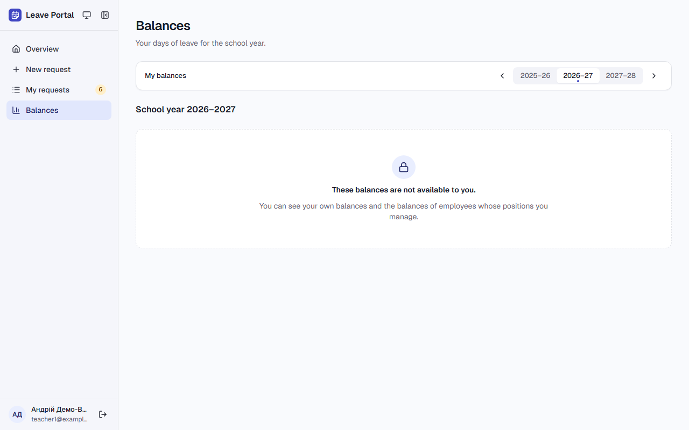
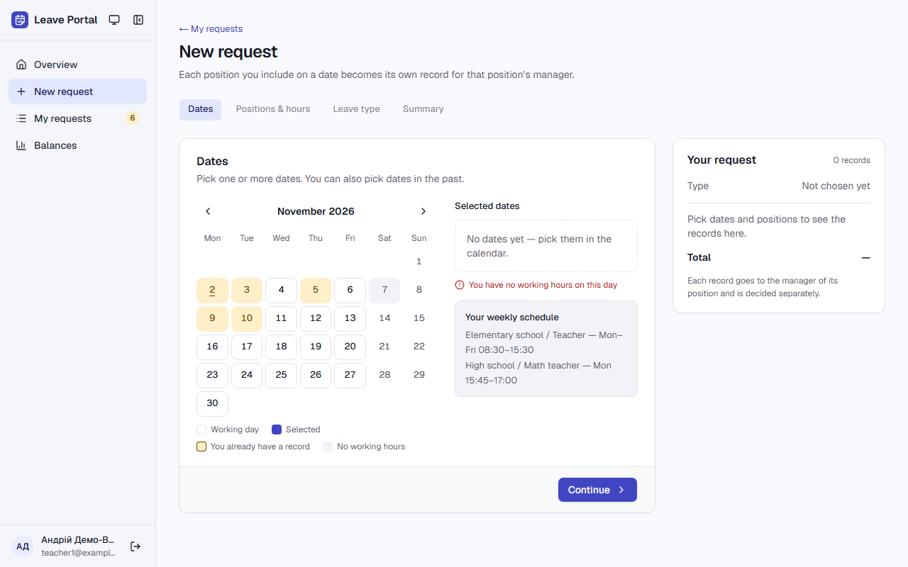
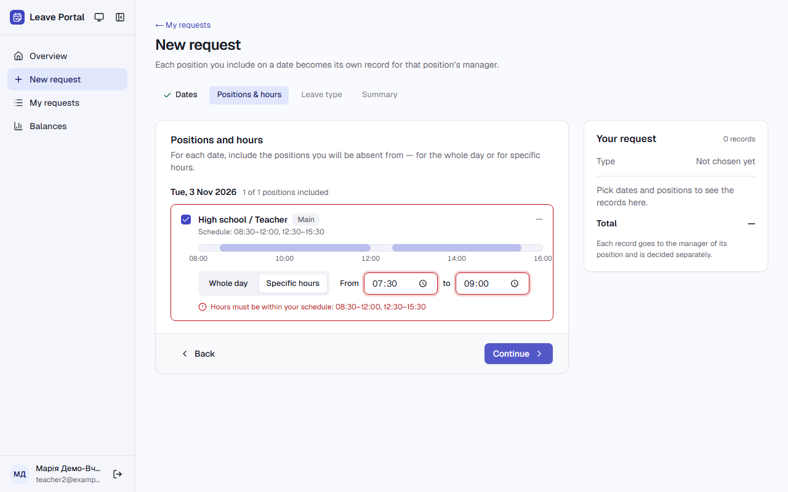

# Звіт UAT — 02.11.2026

- **Застосунок:** https://leave-portal-olive.vercel.app (/api/health: коміт `8abda3d`)
- **Код тестів:** `task/uat` @ `c740a03` + незакомічені зміни
- **Прогін:** 02.11.2026, 12:04 (Київ), Playwright 48.7 с; AC: 3 — PASS 3, FAIL 0, NEEDS-HUMAN 0
- **Рецензент:** `claude-haiku-5-5`; суперечки → `claude-sonnet-5-5`. Разом за розбір: $0.0077 (ціни API; за підпискою — у межах ліміту плану)
- **Прибирання:** не запускалось (прогін без SUPABASE_SECRET_KEY — лише AC, що нічого не пишуть)
- **Відео й траси:** не в git — `test-results/` локально або артефакт CI; трасу відкриває `npx playwright show-trace <trace.zip>`

| AC | Перевірки | Агент | Підсумок | Чому | Playwright | Розбір |
|---|---|---|---|---|---|---|
| AC-BALANCE-13 | пройшли | Haiku: PASS | **PASS** | R6: перевірки, агент і цитати збігаються | 11.6 с | $0.0024, 9.0 с |
| AC-LEAVE-06 | пройшли | Haiku: PASS | **PASS** | R6: перевірки, агент і цитати збігаються | 5.6 с | $0.0027, 10.5 с |
| AC-LEAVE-19 | пройшли | Haiku: PASS | **PASS** | R6: перевірки, агент і цитати збігаються | 13.0 с | $0.0026, 11.9 с |

## AC-BALANCE-13 — PASS

**Тест:** AC-BALANCE-13: teacher1@example.test opens another employee's balances by a direct link — the balances are not shown

**Критерій** (requirements/03-leave-balance.md):

> AC-BALANCE-13: Given employee teacher1@example.test. When teacher1@example.test tries to view another employee's balances. Then the balances are not shown.

**Кроки:** ✔ Дано: employee teacher1@example.test → ✔ Коли: teacher1@example.test tries to view another employee's balances (teacher2@example.test, direct link) → ✔ Тоді: the balances are not shown.

**Агент (claude-haiku-5-5, PASS):** На кадрі frame-then-1.png сторінка /balances (заголовок «Balances», «School year 2026–2027») без карток балансів і без чисел днів. Замість них є напис «These balances are not available to you.», який збігається з критерієм посимвольно. Частини з розділу «Не з кадрів» не оцінювалися.

**Цитати агента, звірені зі сторінкою (aria):**
- «These balances are not available to you.» — є на сторінці

**Правило:** R6: перевірки, агент і цитати збігаються

**Відео:** `test-results/artifacts/balances-AC-BALANCE-13-tea-88477--the-balances-are-not-shown-chromium/video.webm` · **траса:** `test-results/artifacts/balances-AC-BALANCE-13-tea-88477--the-balances-are-not-shown-chromium/trace.zip` (не в git)

**Рішення PM:** ☐ приймаю · ☐ відхилення від вимог (issue «Відхилення від вимог: AC-BALANCE-13 — …») · @login: ____

## AC-LEAVE-06 — PASS

**Тест:** AC-LEAVE-06: Saturday 2026-11-07 is not accepted — «You have no working hours on this day»

**Критерій** (requirements/01-leave-request.md):

> AC-LEAVE-06: Given an employee whose position has no Saturday in its schedule. When the employee tries to choose Saturday 2026-11-07. Then the date is not accepted, and the employee sees the message "You have no working hours on this day".

**Кроки:** ✔ Дано: an employee whose position has no Saturday in its schedule (teacher1@example.test) → ✔ Коли: the employee tries to choose Saturday 2026-11-07 → ✔ Тоді: the date is not accepted, and the employee sees the message "You have no working hours on this day".

**Агент (claude-haiku-5-5, PASS):** На кадрі сторінки «New request» під календарем червоним написано «You have no working hours on this day», а в блоці «Selected dates» видно «No dates yet — pick them in the calendar.». Число 7 у суботньому стовпчику сіре, без виділення, і кнопки «Remove Sat, 7 Nov 2026» немає. Кадр повний, без завантаження, текст читабельний.

**Цитати агента, звірені зі сторінкою (aria):**
- «You have no working hours on this day» — є на сторінці
- «No dates yet — pick them in the calendar.» — є на сторінці

**Правило:** R6: перевірки, агент і цитати збігаються

**Відео:** `test-results/artifacts/new-request-teacher1-examp-a4f9c--working-hours-on-this-day»-chromium/video.webm` · **траса:** `test-results/artifacts/new-request-teacher1-examp-a4f9c--working-hours-on-this-day»-chromium/trace.zip` (не в git)

**Рішення PM:** ☐ приймаю · ☐ відхилення від вимог (issue «Відхилення від вимог: AC-LEAVE-06 — …») · @login: ____

## AC-LEAVE-19 — PASS

**Тест:** AC-LEAVE-19: hours 07:30–09:00 on Tue 2026-11-03 — no request, «Hours must be within your schedule: 08:30–12:00, 12:30–15:30»

**Критерій** (requirements/01-leave-request.md):

> AC-LEAVE-19: Given a position with the schedule blocks Tue 08:30–12:00 and 12:30–15:30. When the employee enters the hours 07:30–09:00 on 2026-11-03. Then no request is created, and the employee sees the message "Hours must be within your schedule: 08:30–12:00, 12:30–15:30".

**Кроки:** ✔ Дано: a position with the schedule blocks Tue 08:30–12:00 and 12:30–15:30 (teacher2@example.test) → ✔ Коли: the employee enters the hours 07:30–09:00 on 2026-11-03 → ✔ Тоді: no request is created, and the employee sees the message "Hours must be within your schedule: 08:30–12:00, 12:30–15:30".

**Агент (claude-haiku-5-5, PASS):** На кадрі видно червоне повідомлення під полем «From 07:30 / to 09:00» з текстом, що збігається з критерієм, і заголовок картки «Positions and hours». Сторінка лишається на кроці «Positions & hours» (у вкладці знак «&», у заголовку — «and»), кнопка «Submit request» відсутня, є лише «Continue». Символи тире на кадрі не вдалося звірити посимвольно, тож це залишається на автоматичній перевірці, як і сказано в AC.

**Цитати агента, звірені зі сторінкою (aria):**
- «Hours must be within your schedule: 08:30–12:00, 12:30–15:30» — є на сторінці
- «Positions and hours» — є на сторінці

**Правило:** R6: перевірки, агент і цитати збігаються

**Відео:** `test-results/artifacts/new-request-teacher2-examp-3cf37-le-08-30–12-00-12-30–15-30»-chromium/video.webm` · **траса:** `test-results/artifacts/new-request-teacher2-examp-3cf37-le-08-30–12-00-12-30–15-30»-chromium/trace.zip` (не в git)

**Рішення PM:** ☐ приймаю · ☐ відхилення від вимог (issue «Відхилення від вимог: AC-LEAVE-19 — …») · @login: ____

## Як читати підсумок

- **PASS** — автоматичні перевірки пройшли, агент-рецензент погодився з кадром, а кожну його цитату знайдено на сторінці.
- **FAIL** — впала автоматична перевірка. Агент цього не перекриває: невидимі вади (буфер обміну, база) він на кадрі не побачить.
- **NEEDS-HUMAN** — перевірки зелені, але агент не погодився або його цитати немає на сторінці. Часто це слабкий тест або розбіжність між текстом AC і тестом — питання до PM, а не обов'язково вада продукту.

Правила: R1: перевірка впала — FAIL завжди, агент не перекриває; R2: немає вердикту агента або кадру; R3: перевірки пройшли, агент не погоджується — вирішує людина; R4: цитати агента немає на сторінці (aria) — не підтверджено; R5: помилка сторінки або 5xx під час сценарію; R6: перевірки, агент і цитати збігаються.
