# Звіт UAT — 08.11.2026

- **Застосунок:** https://leave-portal-olive.vercel.app (/api/health: коміт `c77502a`)
- **Код тестів:** `task/uat-school-calendar` @ `aac4469` + незакомічені зміни
- **Прогін:** 08.11.2026, 23:42 (Київ), Playwright 275.1 с; AC: 18 — PASS 18, FAIL 0, NEEDS-HUMAN 0
- **Рецензент:** `claude-haiku-5-5`; суперечки → `claude-sonnet-5-5`. Разом за розбір: $0.0668 (ціни API; за підпискою — у межах ліміту плану)
- **Прибирання:** рядків UAT шкільного календаря видалено 13 (закриття «Winter break» 2026-12-28…2027-01-08 (зі сторінки); заявка teacher1@example.test 2026-12-29 (зі сторінки); заявка teacher1@example.test 2026-12-29 (зі сторінки); закриття «Winter break» 2026-12-28…2027-01-08 (зі сторінки); закриття «Winter break» 2026-12-28…2027-01-08 (зі сторінки); закриття «Winter break» 2026-12-28…2027-01-08 (зі сторінки); закриття «Winter break» 2026-12-28…2027-01-08 (зі сторінки); заявка teacher1@example.test 2026-11-20 (зі сторінки); закриття «Teachers' meeting» 2026-11-20…2026-11-20 (зі сторінки); закриття «Teachers' meeting» 2026-11-20…2026-11-20 (зі сторінки); заявка teacher1@example.test 2026-11-20 (зі сторінки); закриття «Teachers' meeting» 2026-11-20…2026-11-20 (зі сторінки); закриття «Winter break» 2026-12-28…2027-01-08 (зі сторінки)), закриттів AC лишилось 0, записів teacher1@ у датах AC лишилось 0
- **Відео й траси:** не в git — `test-results/` локально або артефакт CI; трасу відкриває `npx playwright show-trace <trace.zip>`

| AC | Перевірки | Агент | Підсумок | Чому | Playwright | Розбір |
|---|---|---|---|---|---|---|
| AC-BALANCE-13 | пройшли | Haiku: PASS | **PASS** | R6: перевірки, агент і цитати збігаються | 8.1 с | $0.0019, 7.6 с |
| AC-CAL-01 | пройшли | Haiku: PASS | **PASS** | R6: перевірки, агент і цитати збігаються | 12.9 с | $0.0020, 9.2 с |
| AC-CAL-02 | пройшли | Haiku: PASS | **PASS** | R6: перевірки, агент і цитати збігаються | 7.2 с | $0.0019, 8.1 с |
| AC-CAL-03 | пройшли | Haiku: PASS | **PASS** | R6: перевірки, агент і цитати збігаються | 8.4 с | $0.0020, 7.7 с |
| AC-CAL-04 | пройшли | Haiku: PASS | **PASS** | R6: перевірки, агент і цитати збігаються | 15.5 с | $0.0024, 10.2 с |
| AC-CAL-05 | пройшли | Haiku: PASS | **PASS** | R6: перевірки, агент і цитати збігаються | 12.4 с | $0.0021, 8.9 с |
| AC-CAL-06 | пройшли | Haiku: PASS | **PASS** | R6: перевірки, агент і цитати збігаються | 14.6 с | $0.0022, 9.3 с |
| AC-CAL-07 | пройшли | Haiku: PASS | **PASS** | R6: перевірки, агент і цитати збігаються | 14.0 с | $0.0022, 8.7 с |
| AC-CAL-08 | пройшли | Haiku: PASS | **PASS** | R6: перевірки, агент і цитати збігаються | 11.9 с | $0.0020, 7.6 с |
| AC-CAL-09 | пройшли | Haiku: PASS | **PASS** | R6: перевірки, агент і цитати збігаються | 13.0 с | $0.0023, 9.8 с |
| AC-CAL-10 | пройшли | Haiku: PASS | **PASS** | R6: перевірки, агент і цитати збігаються | 12.3 с | $0.0018, 6.7 с |
| AC-CAL-11 | пройшли | Haiku: PASS | **PASS** | R6: перевірки, агент і цитати збігаються | 12.9 с | $0.0020, 8.0 с |
| AC-CAL-12 | пройшли | Haiku: PASS | **PASS** | R6: перевірки, агент і цитати збігаються | 4.8 с | $0.0022, 9.5 с |
| AC-CAL-13 | пройшли | Haiku: NEEDS-HUMAN, Sonnet: PASS | **PASS** | R6: перевірки, агент і цитати збігаються | 8.2 с | $0.0314, 17.2 с |
| AC-CAL-14 | пройшли | Haiku: PASS | **PASS** | R6: перевірки, агент і цитати збігаються | 6.6 с | $0.0020, 7.8 с |
| AC-CAL-15 | пройшли | Haiku: PASS | **PASS** | R6: перевірки, агент і цитати збігаються | 4.6 с | $0.0019, 6.9 с |
| AC-LEAVE-06 | пройшли | Haiku: PASS | **PASS** | R6: перевірки, агент і цитати збігаються | 5.4 с | $0.0021, 8.7 с |
| AC-LEAVE-19 | пройшли | Haiku: PASS | **PASS** | R6: перевірки, агент і цитати збігаються | 11.6 с | $0.0023, 10.1 с |

## AC-BALANCE-13 — PASS

**Тест:** AC-BALANCE-13: teacher1@example.test opens another employee's balances by a direct link — the balances are not shown

**Критерій** (requirements/03-leave-balance.md):

> AC-BALANCE-13: Given employee teacher1@example.test. When teacher1@example.test tries to view another employee's balances. Then the balances are not shown.

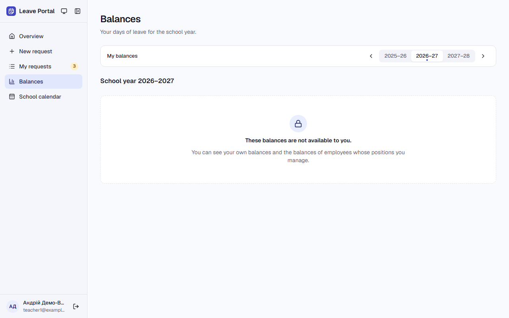

**Кроки:** ✔ Дано: employee teacher1@example.test → ✔ Коли: teacher1@example.test tries to view another employee's balances (teacher2@example.test, direct link) → ✔ Тоді: the balances are not shown.

**Агент (claude-haiku-5-5, PASS):** На кадрі сторінка /balances із заголовком «Balances» і текстом «These balances are not available to you.» під піктограмою замка; карток балансів і чисел днів не видно. Текст повністю збігається з критерієм, тож видима частина «Тоді» виконана.

**Цитати агента, звірені зі сторінкою (aria):**
- «These balances are not available to you.» — є на сторінці

**Правило:** R6: перевірки, агент і цитати збігаються

**Відео:** `test-results/artifacts/balances-AC-BALANCE-13-tea-88477--the-balances-are-not-shown-chromium/video.webm` · **траса:** `test-results/artifacts/balances-AC-BALANCE-13-tea-88477--the-balances-are-not-shown-chromium/trace.zip` (не в git)

**Рішення PM:** ☐ приймаю · ☐ відхилення від вимог (issue «Відхилення від вимог: AC-BALANCE-13 — …») · @login: ____

## AC-CAL-01 — PASS

**Тест:** AC-CAL-01: the administrator adds "Winter break" for whole days 2026-12-28 – 2027-01-08 and the calendar shows it

**Критерій** (requirements/04-school-calendar.md):

> AC-CAL-01: Given the school calendar has no closures. When the administrator adds the closure "Winter break" for whole days from 2026-12-28 to 2027-01-08. Then the school calendar shows "Winter break" with the dates 2026-12-28 – 2027-01-08.

**Кроки:** ✔ Дано: the school calendar has no closures (on the dates of the AC) → ✔ Коли: the administrator adds the closure "Winter break" for whole days from 2026-12-28 to 2027-01-08 → ✔ Тоді: the school calendar shows "Winter break" with the dates 2026-12-28 – 2027-01-08.

**Агент (claude-haiku-5-5, PASS):** На кадрі сторінка «School calendar» (шлях /calendar) з таблицею, де в рядку є дати «2026-12-28 – 2027-01-08» і назва «Winter break» з позначкою «Whole days». Зверху зелено-синє сповіщення «Closure added» з тим самим текстом «Winter break · 2026-12-28 – 2027-01-08», що підтверджує додавання. Частина «exactly one closure» не з кадрів, тому не оцінювалась.

**Цитати агента, звірені зі сторінкою (aria):**
- «Winter break» — є на сторінці
- «2026-12-28 – 2027-01-08» — є на сторінці

**Правило:** R6: перевірки, агент і цитати збігаються

**Відео:** `test-results/artifacts/calendar-admin-example-tes-f5411-8-and-the-calendar-shows-it-chromium/video.webm` · **траса:** `test-results/artifacts/calendar-admin-example-tes-f5411-8-and-the-calendar-shows-it-chromium/trace.zip` (не в git)

**Рішення PM:** ☐ приймаю · ☐ відхилення від вимог (issue «Відхилення від вимог: AC-CAL-01 — …») · @login: ____

## AC-CAL-02 — PASS

**Тест:** AC-CAL-02: teacher1@example.test opens the school calendar and sees "Winter break" 2026-12-28 – 2027-01-08

**Критерій** (requirements/04-school-calendar.md):

> AC-CAL-02: Given the administrator added "Winter break" 2026-12-28 – 2027-01-08. When teacher1@example.test opens the school calendar. Then teacher1@example.test sees "Winter break" with the dates 2026-12-28 – 2027-01-08.

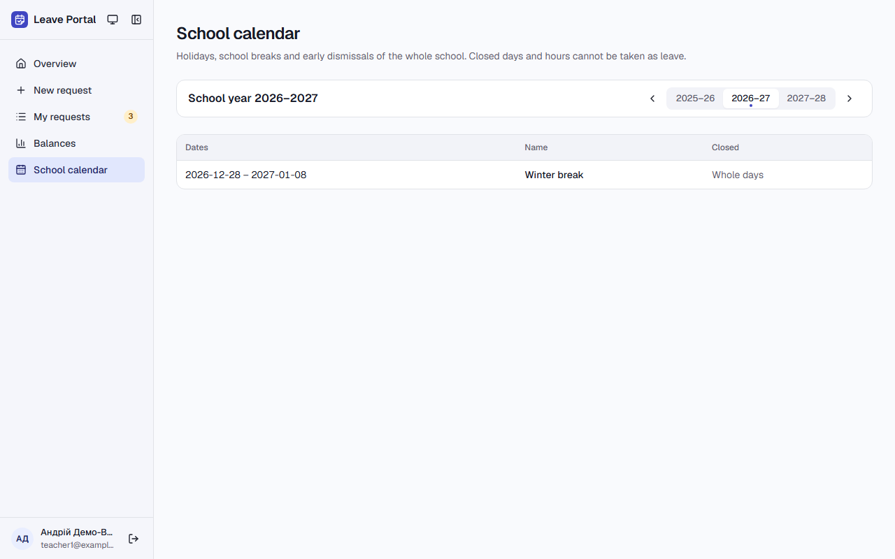

**Кроки:** ✔ Дано: the administrator added "Winter break" 2026-12-28 – 2027-01-08 → ✔ Коли: teacher1@example.test opens the school calendar → ✔ Тоді: teacher1@example.test sees "Winter break" with the dates 2026-12-28 – 2027-01-08.

**Агент (claude-haiku-5-5, PASS):** На кадрі сторінки «School calendar» (школальний рік 2026–2027) видно один рядок таблиці: дати «2026-12-28 – 2027-01-08» і назва «Winter break». Текст читабельний і збігається з критерієм посимвольно, включно з en-dash у діапазоні дат. Ідентичність користувача та навчальний рік не оцінювалися, бо це не з кадрів.

**Цитати агента, звірені зі сторінкою (aria):**
- «2026-12-28 – 2027-01-08» — є на сторінці
- «Winter break» — є на сторінці

**Правило:** R6: перевірки, агент і цитати збігаються

**Відео:** `test-results/artifacts/calendar-teacher1-example--18898-eak-2026-12-28-–-2027-01-08-chromium/video.webm` · **траса:** `test-results/artifacts/calendar-teacher1-example--18898-eak-2026-12-28-–-2027-01-08-chromium/trace.zip` (не в git)

**Рішення PM:** ☐ приймаю · ☐ відхилення від вимог (issue «Відхилення від вимог: AC-CAL-02 — …») · @login: ____

## AC-CAL-03 — PASS

**Тест:** AC-CAL-03: Tuesday 2026-12-29 in "Winter break" is not accepted — «The school is closed on this day: Winter break»

**Критерій** (requirements/04-school-calendar.md):

> AC-CAL-03: Given "Winter break" 2026-12-28 – 2027-01-08 and an employee with the schedule Mon–Fri 08:30–15:30. When the employee tries to choose Tuesday 2026-12-29 in a new request. Then the date is not accepted, and the employee sees the message "The school is closed on this day: Winter break".

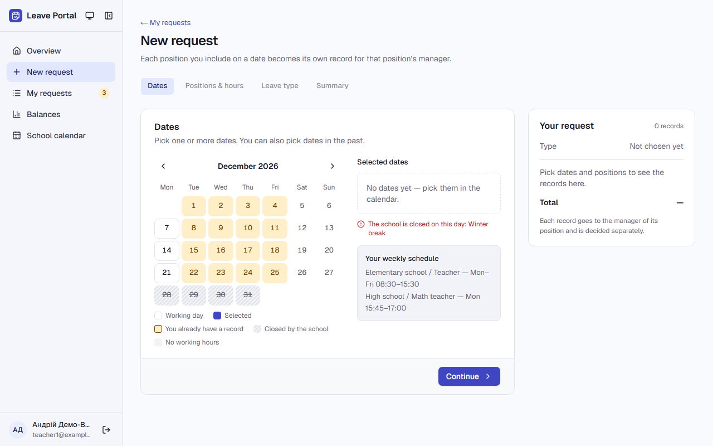

**Кроки:** ✔ Дано: "Winter break" 2026-12-28 – 2027-01-08 and an employee with the schedule Mon–Fri 08:30–15:30 → ✔ Коли: the employee tries to choose Tuesday 2026-12-29 in a new request → ✔ Тоді: the date is not accepted, and the employee sees the message "The school is closed on this day: Winter break".

**Агент (claude-haiku-5-5, PASS):** На кадрі в «Selected dates» видно «No dates yet — pick them in the calendar.», а під календарем червоне повідомлення «The school is closed on this day: Winter break» (перенесене на два рядки через «Winter» / «break», текст збігається). 29 грудня в календарі позначено як «Closed by the school», і в блоці «Selected dates» немає вибраних дат.

**Цитати агента, звірені зі сторінкою (aria):**
- «The school is closed on this day: Winter break» — є на сторінці
- «No dates yet — pick them in the calendar.» — є на сторінці

**Правило:** R6: перевірки, агент і цитати збігаються

**Відео:** `test-results/artifacts/calendar-teacher1-example--69095-d-on-this-day-Winter-break»-chromium/video.webm` · **траса:** `test-results/artifacts/calendar-teacher1-example--69095-d-on-this-day-Winter-break»-chromium/trace.zip` (не в git)

**Рішення PM:** ☐ приймаю · ☐ відхилення від вимог (issue «Відхилення від вимог: AC-CAL-03 — …») · @login: ____

## AC-CAL-04 — PASS

**Тест:** AC-CAL-04: Personal leave for the whole day on the early dismissal 2026-11-20 — 1 record 2026-11-20 08:30–12:00

**Критерій** (requirements/04-school-calendar.md):

> AC-CAL-04: Given an early dismissal "Teachers' meeting" on Friday 2026-11-20 from 12:00 and an employee with the schedule Mon–Fri 08:30–15:30. When the employee requests "Personal leave" for the whole day 2026-11-20 and confirms the summary. Then 1 record 2026-11-20 08:30–12:00 is created.

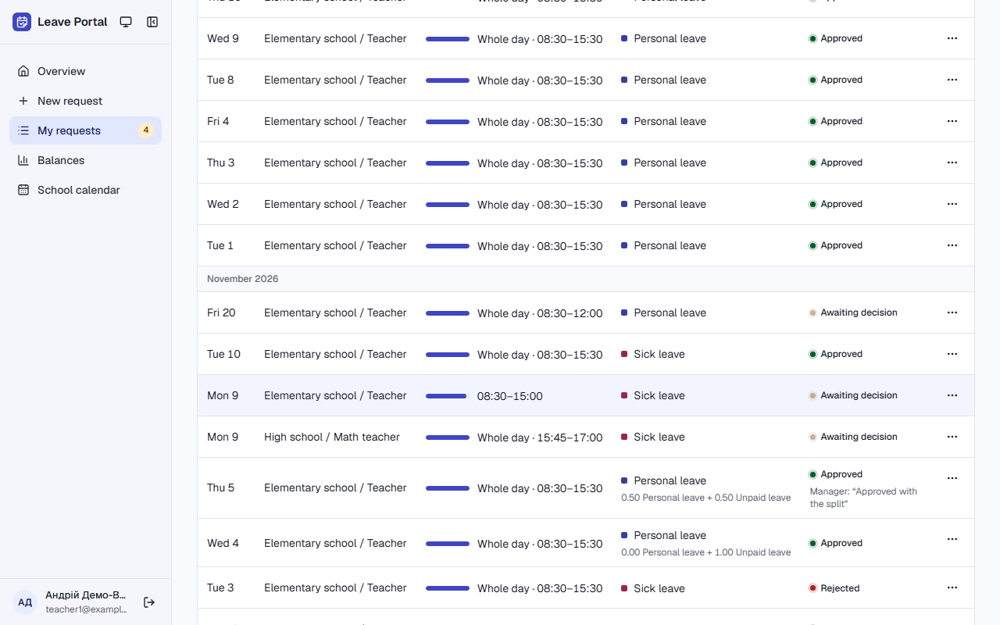

**Кроки:** ✔ Дано: an early dismissal "Teachers' meeting" on Friday 2026-11-20 from 12:00 and an employee with the schedule Mon–Fri 08:30–15:30 → ✔ Коли: the employee requests "Personal leave" for the whole day 2026-11-20 and confirms the summary → ✔ Тоді: 1 record 2026-11-20 08:30–12:00 is created.

**Агент (claude-haiku-5-5, PASS):** На кадрі сторінки /requests в розділі «November 2026» є один рядок «Fri 20» з «Whole day · 08:30–12:00», тип «Personal leave», статус «Awaiting decision». Інших рядків із датою 20 у видимій частині списку немає, а сам запис відповідає вимозі за годинами. Рядок позначено «Whole day», але це мітка типу відсутності, а не суперечність критерію; «Request submitted» і кількість записів за межами кадру не оцінювалися.

**Цитати агента, звірені зі сторінкою (aria):**
- «November 2026» — є на сторінці
- «Fri 20» — є на сторінці
- «Whole day · 08:30–12:00» — є на сторінці
- «Personal leave» — є на сторінці
- «Awaiting decision» — є на сторінці

**Правило:** R6: перевірки, агент і цитати збігаються

**Відео:** `test-results/artifacts/calendar-teacher1-example--a780b-cord-2026-11-20-08-30–12-00-chromium/video.webm` · **траса:** `test-results/artifacts/calendar-teacher1-example--a780b-cord-2026-11-20-08-30–12-00-chromium/trace.zip` (не в git)

**Рішення PM:** ☐ приймаю · ☐ відхилення від вимог (issue «Відхилення від вимог: AC-CAL-04 — …») · @login: ____

## AC-CAL-05 — PASS

**Тест:** AC-CAL-05: hours 13:00–14:00 on the early dismissal 2026-11-20 — no request, «Hours must be within your schedule: 08:30–12:00»

**Критерій** (requirements/04-school-calendar.md):

> AC-CAL-05: Given the early dismissal from AC-CAL-04 and the same employee. When the employee enters the hours 13:00–14:00 on 2026-11-20. Then no request is created, and the employee sees the message "Hours must be within your schedule: 08:30–12:00".

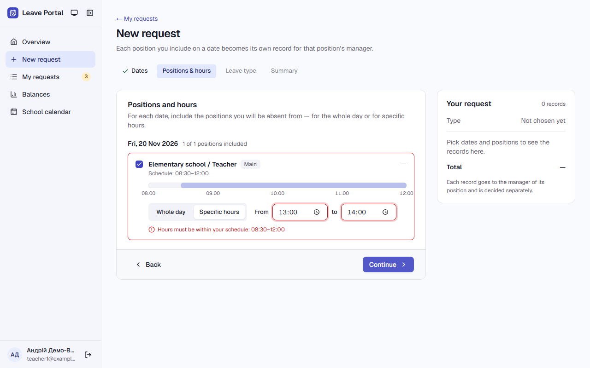

**Кроки:** ✔ Дано: the early dismissal from AC-CAL-04 and the same employee → ✔ Коли: the employee enters the hours 13:00–14:00 on 2026-11-20 → ✔ Тоді: no request is created, and the employee sees the message "Hours must be within your schedule: 08:30–12:00".

**Агент (claude-haiku-5-5, PASS):** На кадрі видно сторінку «New request» з активною вкладкою «Positions & hours» і заголовком картки «Positions and hours». Поля To/From показують 13:00 і 14:00, під ними червоний напис «Hours must be within your schedule: 08:30–12:00». Кнопка внизу — «Continue», без «Submit request»; «Your request» показує «0 records». Точний символ тире перевірятиметься автоматично, тут оцінено лише видимий текст.

**Цитати агента, звірені зі сторінкою (aria):**
- «Hours must be within your schedule: 08:30–12:00» — є на сторінці
- «Positions and hours» — є на сторінці

**Правило:** R6: перевірки, агент і цитати збігаються

**Відео:** `test-results/artifacts/calendar-teacher1-example--73228--your-schedule-08-30–12-00»-chromium/video.webm` · **траса:** `test-results/artifacts/calendar-teacher1-example--73228--your-schedule-08-30–12-00»-chromium/trace.zip` (не в git)

**Рішення PM:** ☐ приймаю · ☐ відхилення від вимог (issue «Відхилення від вимог: AC-CAL-05 — …») · @login: ____

## AC-CAL-06 — PASS

**Тест:** AC-CAL-06: the manager approves the whole-day "Sick leave" 2026-11-20 08:30–12:00 — balances show "Sick leave" used 1.00, not 0.50

**Критерій** (requirements/04-school-calendar.md):

> AC-CAL-06: Given the early dismissal from AC-CAL-04, an employee with a single position (schedule Fri 08:30–15:30) and "Sick leave" used 0.00. When the manager approves the whole-day "Sick leave" record 2026-11-20 08:30–12:00. Then the employee's balances show "Sick leave" used 1.00 (210 of 210 working minutes that day), not 0.50.

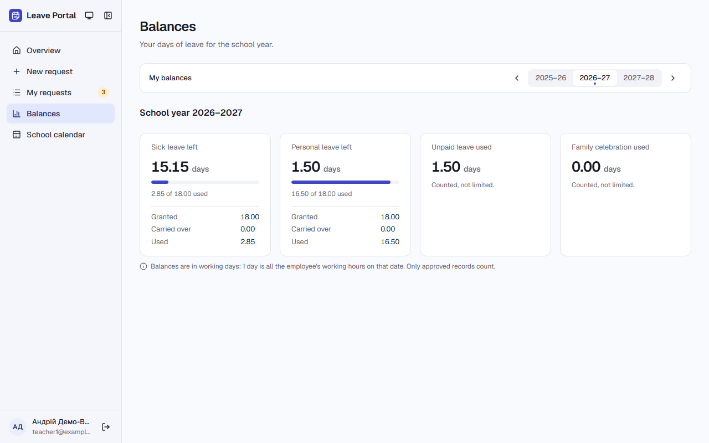

**Кроки:** ✔ Дано: the early dismissal from AC-CAL-04, an employee with a single position (schedule Fri 08:30–15:30) and "Sick leave" used 0.00 → ✔ Коли: the manager approves the whole-day "Sick leave" record 2026-11-20 08:30–12:00 → ✔ Тоді: the employee's balances show "Sick leave" used 1.00 (210 of 210 working minutes that day), not 0.50.

**Агент (claude-haiku-5-5, PASS):** На кадрі /balances картка «Sick leave left» показує «2.85 of 18.00 used» з полем Used 2.85, тобто видима частина «Тоді» присутня. Стартове значення 0.00 і різницю 1.00 (а не 0.50) з одного кадру не перевірити — це частина автоматичних перевірок, яку я не оцінюю.

**Цитати агента, звірені зі сторінкою (aria):**
- «Sick leave left» — є на сторінці
- «2.85 of 18.00 used» — є на сторінці

**Правило:** R6: перевірки, агент і цитати збігаються

**Відео:** `test-results/artifacts/calendar-manager1-example--ee997-ck-leave-used-1-00-not-0-50-chromium/video.webm` · **траса:** `test-results/artifacts/calendar-manager1-example--ee997-ck-leave-used-1-00-not-0-50-chromium/trace.zip` (не в git)

**Рішення PM:** ☐ приймаю · ☐ відхилення від вимог (issue «Відхилення від вимог: AC-CAL-06 — …») · @login: ____

## AC-CAL-07 — PASS

**Тест:** AC-CAL-07: teacher1@example.test's Approved record on 2026-12-29 — "Winter break" is not saved, the message lists the record

**Критерій** (requirements/04-school-calendar.md):

> AC-CAL-07: Given teacher1@example.test has a record 2026-12-29 08:30–15:30 with status "Approved". When the administrator tries to add "Winter break" from 2026-12-28 to 2027-01-08. Then the closure is not saved, the school calendar has no "Winter break", and the administrator sees the message "These days have leave records and cannot be closed: 2026-12-29 teacher1@example.test".

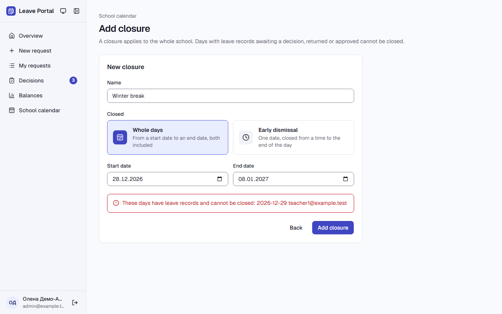

**Кроки:** ✔ Дано: teacher1@example.test has a record 2026-12-29 08:30–15:30 with status "Approved" → ✔ Коли: the administrator tries to add "Winter break" from 2026-12-28 to 2027-01-08 → ✔ Тоді: the closure is not saved, the school calendar has no "Winter break", and the administrator sees the message "These days have leave records and cannot be closed: 2026-12-29 teacher1@example.test".

**Агент (claude-haiku-5-5, PASS):** На кадрі /calendar/manage сторінка «Add closure» відкрита, у полі Name стоїть «Winter break», з датами 28.12.2026 і 08.01.2027. Червоним показано точне повідомлення про заборону закриття з датою 2026-12-29 і адресою teacher1@example.test. Частину про відсутність «Winter break» у календарі кадр не показує, тому її не оцінено.

**Цитати агента, звірені зі сторінкою (aria):**
- «These days have leave records and cannot be closed: 2026-12-29 teacher1@example.test» — є на сторінці
- «Add closure» — є на сторінці
- «Winter break» — є на сторінці

**Правило:** R6: перевірки, агент і цитати збігаються

**Відео:** `test-results/artifacts/calendar-admin-example-tes-975ac-he-message-lists-the-record-chromium/video.webm` · **траса:** `test-results/artifacts/calendar-admin-example-tes-975ac-he-message-lists-the-record-chromium/trace.zip` (не в git)

**Рішення PM:** ☐ приймаю · ☐ відхилення від вимог (issue «Відхилення від вимог: AC-CAL-07 — …») · @login: ____

## AC-CAL-08 — PASS

**Тест:** AC-CAL-08: the only record on 2026-12-29 is Rejected — "Winter break" is saved and shown

**Критерій** (requirements/04-school-calendar.md):

> AC-CAL-08: Given the only record on 2026-12-29 has status "Rejected". When the administrator adds "Winter break" from 2026-12-28 to 2027-01-08. Then the closure is saved, and the school calendar shows "Winter break" with the dates 2026-12-28 – 2027-01-08.

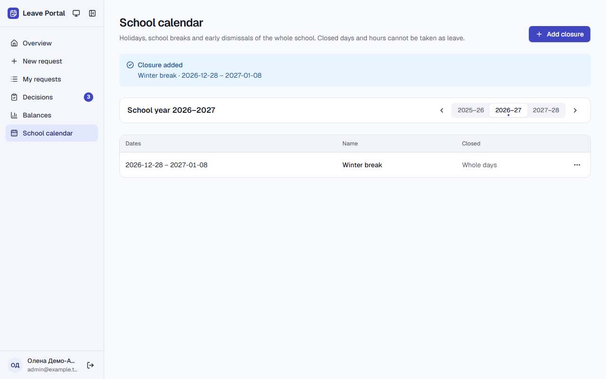

**Кроки:** ✔ Дано: the only record on 2026-12-29 has status "Rejected" → ✔ Коли: the administrator adds "Winter break" from 2026-12-28 to 2027-01-08 → ✔ Тоді: the closure is saved, and the school calendar shows "Winter break" with the dates 2026-12-28 – 2027-01-08.

**Агент (claude-haiku-5-5, PASS):** На кадрі сторінки «School calendar» видно банер «Closure added» з рядком «Winter break · 2026-12-28 – 2027-01-08». Нижче в таблиці є рядок із датами «2026-12-28 – 2027-01-08», назвою «Winter break» і типом «Whole days». Обидві видимі частини «Тоді» підтверджено дослівно.

**Цитати агента, звірені зі сторінкою (aria):**
- «Closure added» — є на сторінці
- «2026-12-28 – 2027-01-08» — є на сторінці
- «Winter break» — є на сторінці

**Правило:** R6: перевірки, агент і цитати збігаються

**Відео:** `test-results/artifacts/calendar-admin-example-tes-eb789-er-break-is-saved-and-shown-chromium/video.webm` · **траса:** `test-results/artifacts/calendar-admin-example-tes-eb789-er-break-is-saved-and-shown-chromium/trace.zip` (не в git)

**Рішення PM:** ☐ приймаю · ☐ відхилення від вимог (issue «Відхилення від вимог: AC-CAL-08 — …») · @login: ____

## AC-CAL-09 — PASS

**Тест:** AC-CAL-09: after the administrator removes "Winter break", Tuesday 2026-12-29 is accepted with the hours 08:30–15:30

**Критерій** (requirements/04-school-calendar.md):

> AC-CAL-09: Given "Winter break" 2026-12-28 – 2027-01-08 and an employee with the schedule Mon–Fri 08:30–15:30. When the administrator removes "Winter break" and the employee then chooses Tuesday 2026-12-29 in a new request. Then the school calendar no longer shows "Winter break", and 2026-12-29 is accepted with the hours 08:30–15:30.

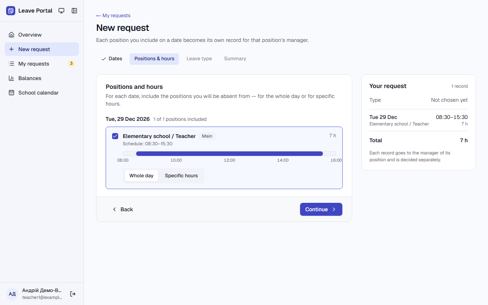

**Кроки:** ✔ Дано: "Winter break" 2026-12-28 – 2027-01-08 and an employee with the schedule Mon–Fri 08:30–15:30 → ✔ Коли: the administrator removes "Winter break" and the employee then chooses Tuesday 2026-12-29 in a new request → ✔ Тоді: the school calendar no longer shows "Winter break", and 2026-12-29 is accepted with the hours 08:30–15:30.

**Агент (claude-haiku-5-5, PASS):** На кадрі сторінка «New request» з кроком «Positions and hours» (картка з цим заголовком). Для «Tue, 29 Dec 2026» показано «Elementary school / Teacher», «Schedule: 08:30–15:30», вибрано «Whole day», у блоці «Your request» — 08:30–15:30, 7 h. Частину «school calendar no longer shows» кадр не перевіряє і я її не оцінював.

**Цитати агента, звірені зі сторінкою (aria):**
- «Positions and hours» — є на сторінці
- «Tue, 29 Dec 2026» — є на сторінці
- «Schedule: 08:30–15:30» — є на сторінці
- «Whole day» — є на сторінці

**Правило:** R6: перевірки, агент і цитати збігаються

**Відео:** `test-results/artifacts/calendar-teacher1-example--95f0c--with-the-hours-08-30–15-30-chromium/video.webm` · **траса:** `test-results/artifacts/calendar-teacher1-example--95f0c--with-the-hours-08-30–15-30-chromium/trace.zip` (не в git)

**Рішення PM:** ☐ приймаю · ☐ відхилення від вимог (issue «Відхилення від вимог: AC-CAL-09 — …») · @login: ____

## AC-CAL-10 — PASS

**Тест:** AC-CAL-10: an end date 2026-12-28 before the start date 2027-01-08 — not saved, «The end date cannot be earlier than the start date»

**Критерій** (requirements/04-school-calendar.md):

> AC-CAL-10: Given the administrator adds a closure. When the administrator enters the start date 2027-01-08 and the end date 2026-12-28. Then the closure is not saved, and the administrator sees the message "The end date cannot be earlier than the start date".

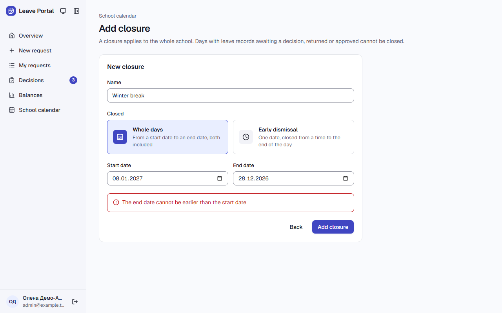

**Кроки:** ✔ Дано: the administrator adds a closure → ✔ Коли: the administrator enters the start date 2027-01-08 and the end date 2026-12-28 → ✔ Тоді: the closure is not saved, and the administrator sees the message "The end date cannot be earlier than the start date".

**Агент (claude-haiku-5-5, PASS):** На кадрі форма «Add closure» з червоним повідомленням під полями дат: «The end date cannot be earlier than the start date», посимвольно збігається з критерієм. Поля показують 08.01.2027 і 28.12.2026, кнопка «Add closure» видима. Збереження та наявність «Winter break» у календарі з кадру не перевірялися (це не з кадрів).

**Цитати агента, звірені зі сторінкою (aria):**
- «The end date cannot be earlier than the start date» — є на сторінці

**Правило:** R6: перевірки, агент і цитати збігаються

**Відео:** `test-results/artifacts/calendar-admin-example-tes-8153d-arlier-than-the-start-date»-chromium/video.webm` · **траса:** `test-results/artifacts/calendar-admin-example-tes-8153d-arlier-than-the-start-date»-chromium/trace.zip` (не в git)

**Рішення PM:** ☐ приймаю · ☐ відхилення від вимог (issue «Відхилення від вимог: AC-CAL-10 — …») · @login: ____

## AC-CAL-11 — PASS

**Тест:** AC-CAL-11: "Staff day" on 2026-12-30 inside "Winter break" — not saved, «2026-12-30 is already closed: Winter break»

**Критерій** (requirements/04-school-calendar.md):

> AC-CAL-11: Given "Winter break" 2026-12-28 – 2027-01-08. When the administrator tries to add the closure "Staff day" for 2026-12-30. Then the closure is not saved, and the administrator sees the message "2026-12-30 is already closed: Winter break".

**Кроки:** ✔ Дано: "Winter break" 2026-12-28 – 2027-01-08 → ✔ Коли: the administrator tries to add the closure "Staff day" for 2026-12-30 → ✔ Тоді: the closure is not saved, and the administrator sees the message "2026-12-30 is already closed: Winter break".

**Агент (claude-haiku-5-5, PASS):** На кадрі видно форму «Add closure» із назвою «Staff day», датами 30.12.2026 і червоним повідомленням про помилку, яке збігається з критерієм посимвольно. Адресного рядка на кадрі немає, тож шлях /calendar/manage не підтверджено кадром; це не впливає на оцінку видимої частини «Тоді». Факт, що закриття не збережено, з кадру не перевіряється.

**Цитати агента, звірені зі сторінкою (aria):**
- «2026-12-30 is already closed: Winter break» — є на сторінці

**Правило:** R6: перевірки, агент і цитати збігаються

**Відео:** `test-results/artifacts/calendar-admin-example-tes-f825e-lready-closed-Winter-break»-chromium/video.webm` · **траса:** `test-results/artifacts/calendar-admin-example-tes-f825e-lready-closed-Winter-break»-chromium/trace.zip` (не в git)

**Рішення PM:** ☐ приймаю · ☐ відхилення від вимог (issue «Відхилення від вимог: AC-CAL-11 — …») · @login: ____

## AC-CAL-12 — PASS

**Тест:** AC-CAL-12: teacher1@example.test opens the page for changing the school calendar — «Only an administrator can change the school calendar»

**Критерій** (requirements/04-school-calendar.md):

> AC-CAL-12: Given teacher1@example.test is signed in and has only the employee role. When teacher1@example.test opens the page for changing the school calendar by a direct link. Then teacher1@example.test sees the message "Only an administrator can change the school calendar", and the school calendar is unchanged.

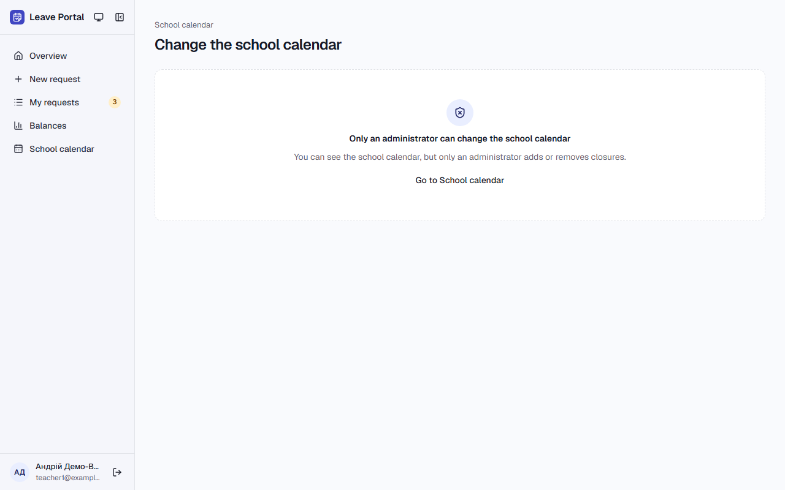

**Кроки:** ✔ Дано: teacher1@example.test is signed in and has only the employee role → ✔ Коли: teacher1@example.test opens the page for changing the school calendar by a direct link → ✔ Тоді: teacher1@example.test sees the message "Only an administrator can change the school calendar", and the school calendar is unchanged.

**Агент (claude-haiku-5-5, PASS):** На кадрі сторінки «Change the school calendar» видно повідомлення «Only an administrator can change the school calendar» і пояснення «You can see the school calendar, but only an administrator adds or removes closures.». Форми додавання канікул на кадрі немає, єдина дія — посилання «Go to School calendar». Факт незмінності календаря не з кадрів, тому не оцінювався.

**Цитати агента, звірені зі сторінкою (aria):**
- «Only an administrator can change the school calendar» — є на сторінці
- «Go to School calendar» — є на сторінці

**Правило:** R6: перевірки, агент і цитати збігаються

**Відео:** `test-results/artifacts/calendar-teacher1-example--4d345-change-the-school-calendar»-chromium/video.webm` · **траса:** `test-results/artifacts/calendar-teacher1-example--4d345-change-the-school-calendar»-chromium/trace.zip` (не в git)

**Рішення PM:** ☐ приймаю · ☐ відхилення від вимог (issue «Відхилення від вимог: AC-CAL-12 — …») · @login: ____

## AC-CAL-13 — PASS

**Тест:** AC-CAL-13: manager1@example.test tries to close 2026-11-27 directly — the calendar is unchanged and 2026-11-27 is still accepted

**Критерій** (requirements/04-school-calendar.md):

> AC-CAL-13: Given manager1@example.test is signed in and is not an administrator. When manager1@example.test tries to close 2026-11-27 directly, bypassing the portal's pages. Then the school calendar is unchanged, and 2026-11-27 is still accepted in a new request.

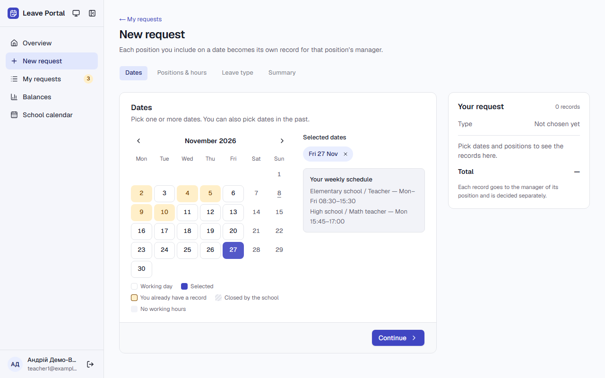

**Кроки:** ✔ Дано: manager1@example.test is signed in and is not an administrator → ✔ Коли: manager1@example.test tries to close 2026-11-27 directly, bypassing the portal's pages → ✔ Тоді: the school calendar is unchanged, and 2026-11-27 is still accepted in a new request.

**Агент (claude-sonnet-5-5, PASS):** На кадрі сторінка New request, листопад 2026: 27-ме виділене, під «Selected dates» є чіп «Fri 27 Nov». Дата не позначена як закрита школою.

Haiku сказав NEEDS-HUMAN, тож розбір повторив Sonnet; рішення агента — за Sonnet.

**Цитати агента, звірені зі сторінкою (aria):**
- «Selected dates» — є на сторінці
- «Fri 27 Nov» — є на сторінці

**Правило:** R6: перевірки, агент і цитати збігаються

**Відео:** `test-results/artifacts/calendar-manager1-example--2051b-026-11-27-is-still-accepted-chromium/video.webm` · **траса:** `test-results/artifacts/calendar-manager1-example--2051b-026-11-27-is-still-accepted-chromium/trace.zip` (не в git)

**Рішення PM:** ☐ приймаю · ☐ відхилення від вимог (issue «Відхилення від вимог: AC-CAL-13 — …») · @login: ____

## AC-CAL-14 — PASS

**Тест:** AC-CAL-14: a visitor who is not signed in opens the school calendar by a direct link — the sign-in page, no closure names or dates

**Критерій** (requirements/04-school-calendar.md):

> AC-CAL-14: Given nobody is signed in. When a visitor opens the school calendar by a direct link. Then the visitor sees the sign-in page, and no closure names or dates are shown.

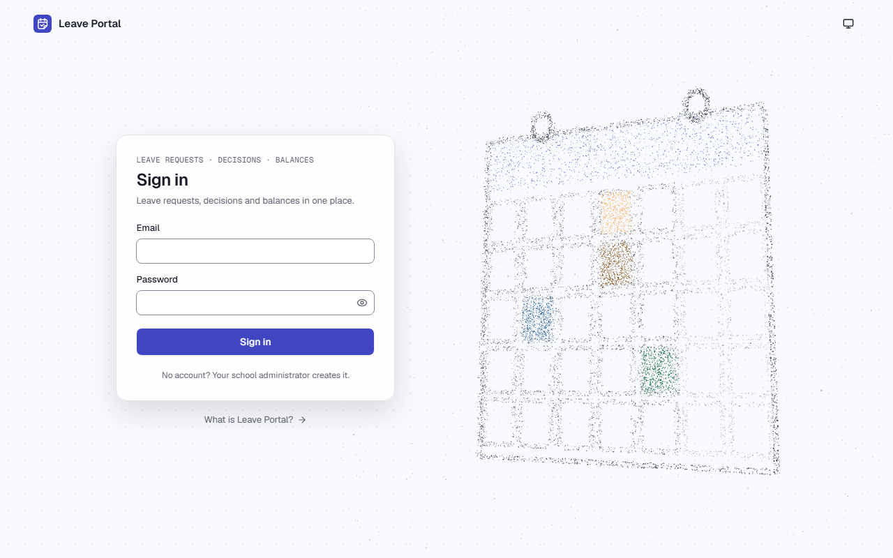

**Кроки:** ✔ Дано: nobody is signed in (and the school calendar has a closure, so there is something to hide) → ✔ Коли: a visitor opens the school calendar by a direct link → ✔ Тоді: the visitor sees the sign-in page, and no closure names or dates are shown.

**Агент (claude-haiku-5-5, PASS):** На кадрі frame-then-1.png видно сторінку входу Leave Portal із заголовком «Sign in», полями «Email» і «Password» та кнопкою «Sign in». Календаря з назвами чи датами закриттів на кадрі немає, тож відсутність цих даних на кадрі не суперечить критерію. Перевірку відсутності «Winter break» і «2026-12-28» на сторінці я не оцінював, бо це поза кадрами.

**Цитати агента, звірені зі сторінкою (aria):**
- «Email» — є на сторінці
- «Password» — є на сторінці
- «Sign in» — є на сторінці

**Правило:** R6: перевірки, агент і цитати збігаються

**Відео:** `test-results/artifacts/calendar-AC-CAL-14-a-visit-8a3ad-e-no-closure-names-or-dates-chromium/video.webm` · **траса:** `test-results/artifacts/calendar-AC-CAL-14-a-visit-8a3ad-e-no-closure-names-or-dates-chromium/trace.zip` (не в git)

**Рішення PM:** ☐ приймаю · ☐ відхилення від вимог (issue «Відхилення від вимог: AC-CAL-14 — …») · @login: ____

## AC-CAL-15 — PASS

**Тест:** AC-CAL-15: no closures in school year 2026–2027 — «No closed days in school year 2026–2027»

**Критерій** (requirements/04-school-calendar.md):

> AC-CAL-15: Given the school calendar has no closures in school year 2026–2027. When an employee opens the school calendar for school year 2026–2027. Then the employee sees the message "No closed days in school year 2026–2027".

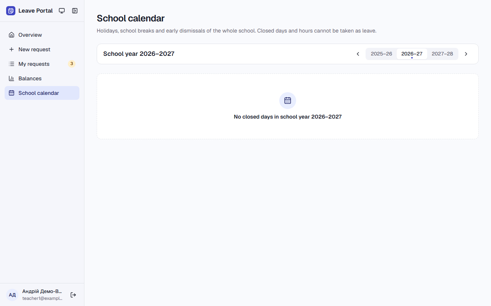

**Кроки:** ✔ Дано: the school calendar has no closures in school year 2026–2027 → ✔ Коли: an employee opens the school calendar for school year 2026–2027 → ✔ Тоді: the employee sees the message "No closed days in school year 2026–2027".

**Агент (claude-haiku-5-5, PASS):** На кадрі розділ School calendar з вибраним періодом 2026–27 і повідомлення по центру порожнього блоку: "No closed days in school year 2026–2027". Текст збігається з критерієм, включно з тире між роками. Рядків із закриттями на кадрі немає, що узгоджується з «Дано»; ця частина не з кадрів і не оцінювалась.

**Цитати агента, звірені зі сторінкою (aria):**
- «No closed days in school year 2026–2027» — є на сторінці

**Правило:** R6: перевірки, агент і цитати збігаються

**Відео:** `test-results/artifacts/calendar-teacher1-example--18069-s-in-school-year-2026–2027»-chromium/video.webm` · **траса:** `test-results/artifacts/calendar-teacher1-example--18069-s-in-school-year-2026–2027»-chromium/trace.zip` (не в git)

**Рішення PM:** ☐ приймаю · ☐ відхилення від вимог (issue «Відхилення від вимог: AC-CAL-15 — …») · @login: ____

## AC-LEAVE-06 — PASS

**Тест:** AC-LEAVE-06: Saturday 2026-11-07 is not accepted — «You have no working hours on this day»

**Критерій** (requirements/01-leave-request.md):

> AC-LEAVE-06: Given an employee whose position has no Saturday in its schedule. When the employee tries to choose Saturday 2026-11-07. Then the date is not accepted, and the employee sees the message "You have no working hours on this day".

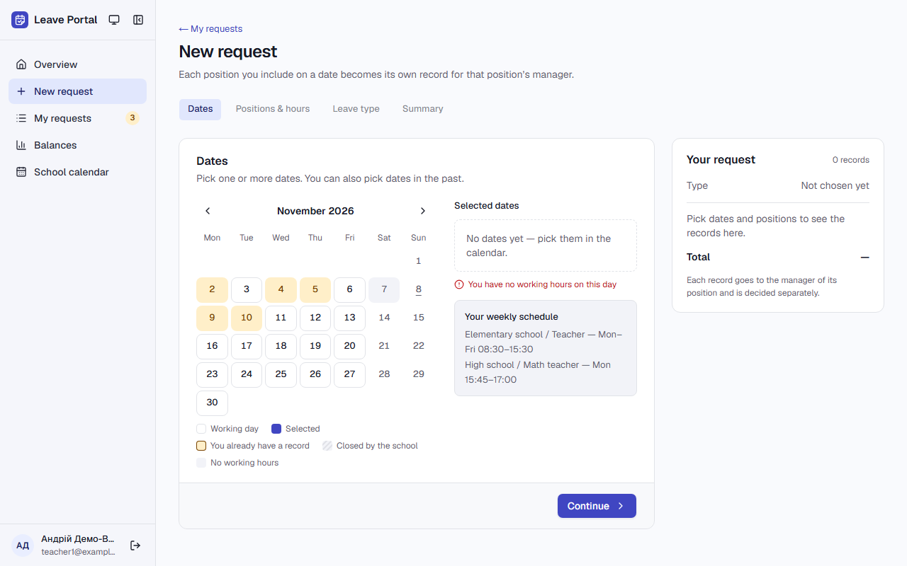

**Кроки:** ✔ Дано: an employee whose position has no Saturday in its schedule (teacher1@example.test) → ✔ Коли: the employee tries to choose Saturday 2026-11-07 → ✔ Тоді: the date is not accepted, and the employee sees the message "You have no working hours on this day".

**Агент (claude-haiku-5-5, PASS):** На кадрі сторінки /requests/new у календарі листопада 2026 субота 7 (Sat) сіра, без вибору, і під календарем червоним написано «You have no working hours on this day». У блоці «Selected dates» видно «No dates yet — pick them in the calendar.», тобто 7 листопада не в обраних датах. Обидві видимі частини «Тоді» підтверджено дослівно; частину «Не з кадрів» не оцінював.

**Цитати агента, звірені зі сторінкою (aria):**
- «You have no working hours on this day» — є на сторінці
- «No dates yet — pick them in the calendar.» — є на сторінці

**Правило:** R6: перевірки, агент і цитати збігаються

**Відео:** `test-results/artifacts/new-request-teacher1-examp-a4f9c--working-hours-on-this-day»-chromium/video.webm` · **траса:** `test-results/artifacts/new-request-teacher1-examp-a4f9c--working-hours-on-this-day»-chromium/trace.zip` (не в git)

**Рішення PM:** ☐ приймаю · ☐ відхилення від вимог (issue «Відхилення від вимог: AC-LEAVE-06 — …») · @login: ____

## AC-LEAVE-19 — PASS

**Тест:** AC-LEAVE-19: hours 07:30–09:00 on Tue 2026-11-03 — no request, «Hours must be within your schedule: 08:30–12:00, 12:30–15:30»

**Критерій** (requirements/01-leave-request.md):

> AC-LEAVE-19: Given a position with the schedule blocks Tue 08:30–12:00 and 12:30–15:30. When the employee enters the hours 07:30–09:00 on 2026-11-03. Then no request is created, and the employee sees the message "Hours must be within your schedule: 08:30–12:00, 12:30–15:30".

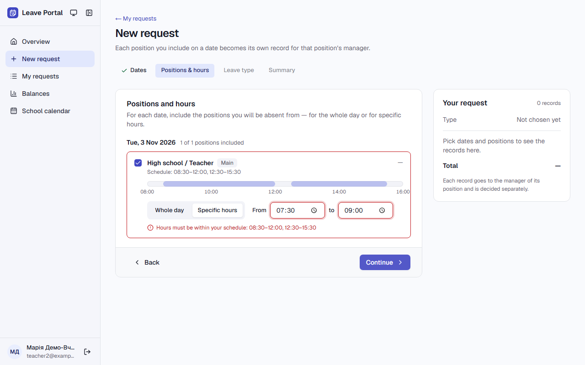

**Кроки:** ✔ Дано: a position with the schedule blocks Tue 08:30–12:00 and 12:30–15:30 (teacher2@example.test) → ✔ Коли: the employee enters the hours 07:30–09:00 on 2026-11-03 → ✔ Тоді: no request is created, and the employee sees the message "Hours must be within your schedule: 08:30–12:00, 12:30–15:30".

**Агент (claude-haiku-5-5, PASS):** На кадрі сторінка «New request» на кроці позицій: під полем «to 09:00» червоним написано «Hours must be within your schedule: 08:30–12:00, 12:30–15:30», поля часу підсвічені помилкою. Заголовок картки «Positions and hours» є, кнопка внизу «Continue», а «Submit request» не видно; у вкладці кроку написано «Positions & hours», але це не частина критерію «Тоді».

**Цитати агента, звірені зі сторінкою (aria):**
- «Hours must be within your schedule: 08:30–12:00, 12:30–15:30» — є на сторінці
- «Positions and hours» — є на сторінці
- «Continue» — є на сторінці

**Правило:** R6: перевірки, агент і цитати збігаються

**Відео:** `test-results/artifacts/new-request-teacher2-examp-3cf37-le-08-30–12-00-12-30–15-30»-chromium/video.webm` · **траса:** `test-results/artifacts/new-request-teacher2-examp-3cf37-le-08-30–12-00-12-30–15-30»-chromium/trace.zip` (не в git)

**Рішення PM:** ☐ приймаю · ☐ відхилення від вимог (issue «Відхилення від вимог: AC-LEAVE-19 — …») · @login: ____

## Як читати підсумок

- **PASS** — автоматичні перевірки пройшли, агент-рецензент погодився з кадром, а кожну його цитату знайдено на сторінці.
- **FAIL** — впала автоматична перевірка. Агент цього не перекриває: невидимі вади (буфер обміну, база) він на кадрі не побачить.
- **NEEDS-HUMAN** — перевірки зелені, але агент не погодився або його цитати немає на сторінці. Часто це слабкий тест або розбіжність між текстом AC і тестом — питання до PM, а не обов'язково вада продукту.

Правила: R1: перевірка впала — FAIL завжди, агент не перекриває; R2: немає вердикту агента або кадру; R3: перевірки пройшли, агент не погоджується — вирішує людина; R4: цитати агента немає на сторінці (aria) — не підтверджено; R5: помилка сторінки або 5xx під час сценарію; R6: перевірки, агент і цитати збігаються.
