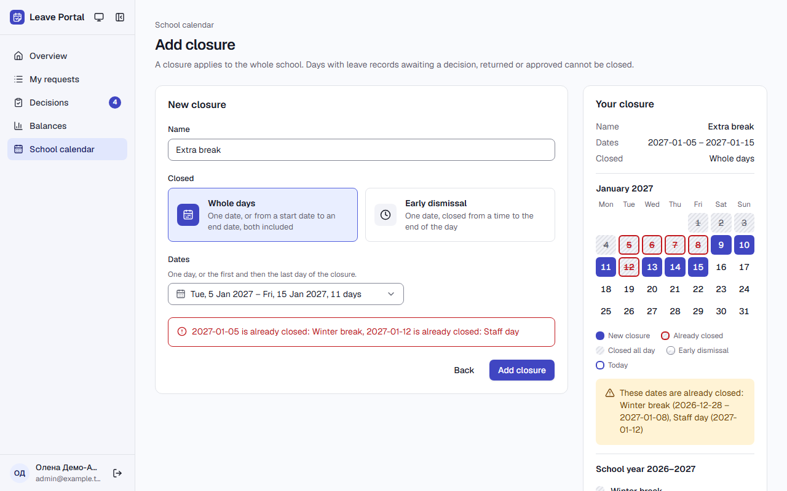
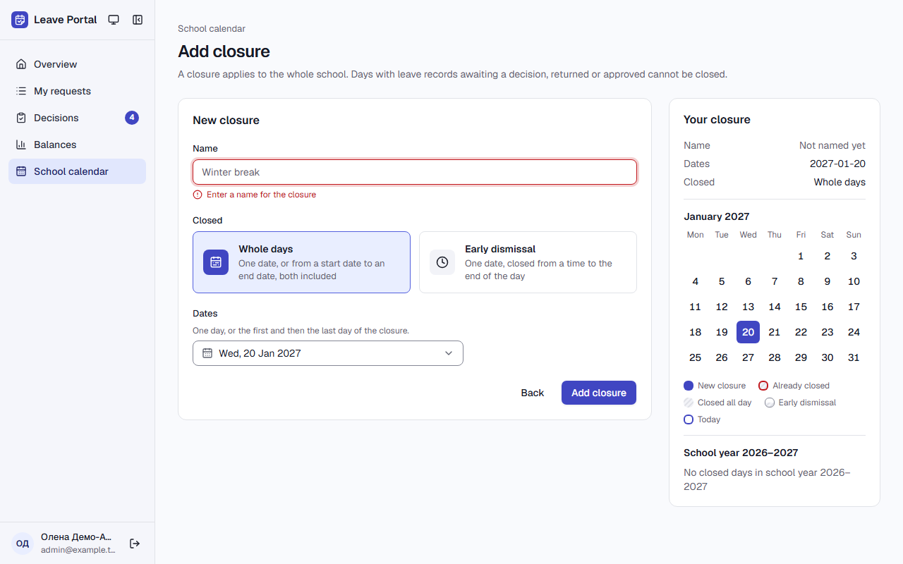
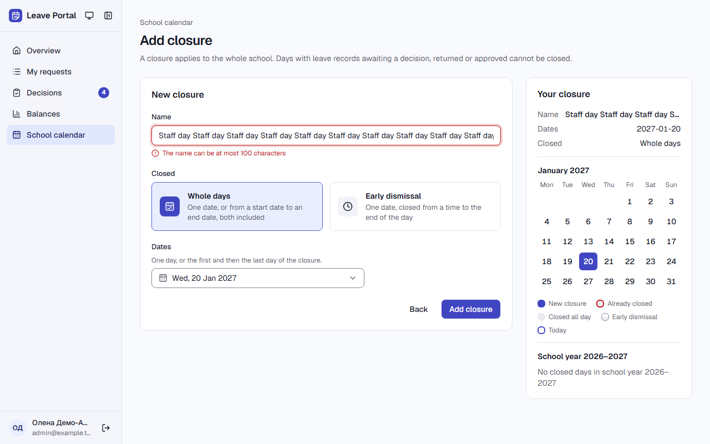
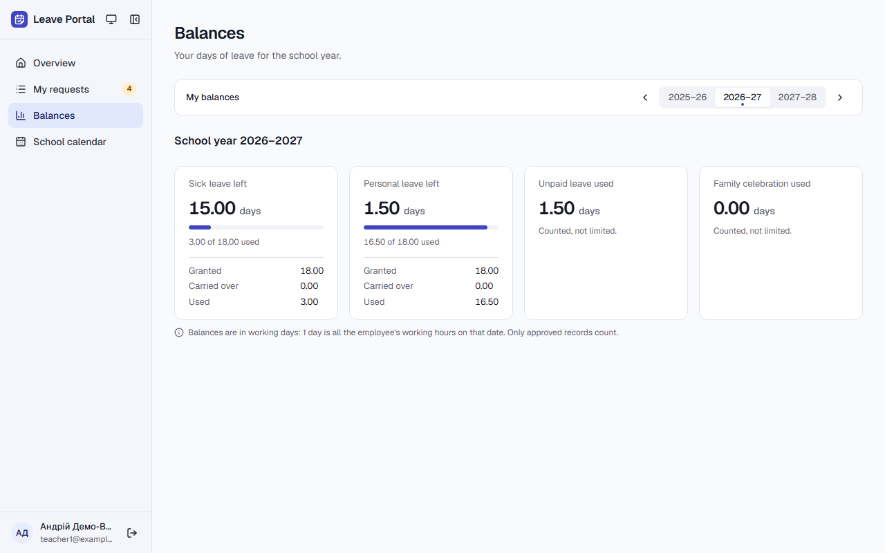

# Звіт UAT — 13.11.2026

- **Застосунок:** https://leave-portal-olive.vercel.app (/api/health: коміт `4f390f9`)
- **Код тестів:** `task/uat-cal-16-20` @ `4f390f9` + незакомічені зміни
- **Прогін:** 13.11.2026, 18:02 (Київ), Playwright 132.3 с; AC: 4 — PASS 4, FAIL 0, NEEDS-HUMAN 0
- **Рецензент:** `claude-haiku-5-5`; суперечки → `claude-sonnet-5-5`. Разом за розбір: $0.0754 (ціни API; за підпискою — у межах ліміту плану)
- **Прибирання:** рядків UAT шкільного календаря видалено 4 (закриття «Staff day» 2027-01-12…2027-01-12; закриття «Winter break» 2026-12-28…2027-01-08; закриття «Teachers' meeting» 2026-11-20…2026-11-20 (зі сторінки); заявка teacher1@example.test 2026-11-20), закриттів AC лишилось 0, записів teacher1@ у датах AC лишилось 0
- **Відео й траси:** не в git — `test-results/` локально або артефакт CI; трасу відкриває `npx playwright show-trace <trace.zip>`

| AC | Перевірки | Агент | Підсумок | Чому | Playwright | Розбір |
|---|---|---|---|---|---|---|
| AC-CAL-17 | пройшли | Haiku: PASS | **PASS** | R6: перевірки, агент і цитати збігаються | 24.1 с | $0.0019, 32.7 с |
| AC-CAL-18 | пройшли | Haiku: PASS | **PASS** | R6: перевірки, агент і цитати збігаються | 20.9 с | $0.0022, 31.9 с |
| AC-CAL-19 | пройшли | Sonnet: PASS | **PASS** | R6: перевірки, агент і цитати збігаються | 22.4 с | $0.0362, 36.3 с |
| AC-CAL-20 | пройшли | Haiku: NEEDS-HUMAN, Sonnet: PASS | **PASS** | R6: перевірки, агент і цитати збігаються | 27.4 с | $0.0351, 29.0 с |

## AC-CAL-17 — PASS

**Тест:** AC-CAL-17: "Extra break" 2027-01-05 – 2027-01-15 over "Winter break" and "Staff day" — not saved, one message part per closure

**Критерій** (requirements/04-school-calendar.md):

> AC-CAL-17: Given "Winter break" 2026-12-28 – 2027-01-08 and "Staff day" 2027-01-12. When the administrator tries to add "Extra break" from 2027-01-05 to 2027-01-15. Then the closure is not saved, and the administrator sees the message "2027-01-05 is already closed: Winter break, 2027-01-12 is already closed: Staff day".

**Кроки:** ✔ Дано: "Winter break" 2026-12-28 – 2027-01-08 and "Staff day" 2027-01-12 → ✔ Коли: the administrator tries to add "Extra break" from 2027-01-05 to 2027-01-15 → ✔ Тоді: the closure is not saved, and the administrator sees the message "2027-01-05 is already closed: Winter break, 2027-01-12 is already closed: Staff day".

**Агент (claude-haiku-5-5, PASS):** На кадрі сторінка «Add closure» (/calendar/manage) з полем Name «Extra break» і датами 2027-01-05 – 2027-01-15 та червоним блоком помилки з текстом, який збігається з критерієм посимвольно. Факт «не збережено» з кадру не видно, тому оцінено лише видиму частину «Тоді».

**Цитати агента, звірені зі сторінкою (aria):**
- «2027-01-05 is already closed: Winter break, 2027-01-12 is already closed: Staff day» — є на сторінці

**Правило:** R6: перевірки, агент і цитати збігаються

**Відео:** `test-results/artifacts/calendar-admin-example-tes-d9e81-ne-message-part-per-closure-chromium/video.webm` · **траса:** `test-results/artifacts/calendar-admin-example-tes-d9e81-ne-message-part-per-closure-chromium/trace.zip` (не в git)

**Рішення PM:** ☐ приймаю · ☐ відхилення від вимог (issue «Відхилення від вимог: AC-CAL-17 — …») · @login: ____

## AC-CAL-18 — PASS

**Тест:** AC-CAL-18: the administrator leaves the name empty for 2027-01-20 — not saved, «Enter a name for the closure»

**Критерій** (requirements/04-school-calendar.md):

> AC-CAL-18: Given the administrator adds a closure for 2027-01-20. When the administrator leaves the name empty and tries to save. Then the closure is not saved, and the administrator sees the message "Enter a name for the closure".

**Кроки:** ✔ Дано: the administrator adds a closure for 2027-01-20 → ✔ Коли: the administrator leaves the name empty and tries to save → ✔ Тоді: the closure is not saved, and the administrator sees the message "Enter a name for the closure".

**Агент (claude-haiku-5-5, PASS):** На кадрі під полем «Name» червоним текстом написано «Enter a name for the closure», що посимвольно збігається з критерієм. Форма «Add closure» залишається відкритою, поле порожнє з червоною рамкою, дата 2027-01-20 видна в панелі «Your closure» — це узгоджується з тим, що закриття не збережено, але це не оцінювалося.

**Цитати агента, звірені зі сторінкою (aria):**
- «Enter a name for the closure» — є на сторінці

**Правило:** R6: перевірки, агент і цитати збігаються

**Відео:** `test-results/artifacts/calendar-admin-example-tes-9fbb6-ter-a-name-for-the-closure»-chromium/video.webm` · **траса:** `test-results/artifacts/calendar-admin-example-tes-9fbb6-ter-a-name-for-the-closure»-chromium/trace.zip` (не в git)

**Рішення PM:** ☐ приймаю · ☐ відхилення від вимог (issue «Відхилення від вимог: AC-CAL-18 — …») · @login: ____

## AC-CAL-19 — PASS

**Тест:** AC-CAL-19: a name of 101 characters for 2027-01-20 — not saved, «The name can be at most 100 characters»

**Критерій** (requirements/04-school-calendar.md):

> AC-CAL-19: Given the administrator adds a closure for 2027-01-20. When the administrator enters a name of 101 characters and tries to save. Then the closure is not saved, and the administrator sees the message "The name can be at most 100 characters".

**Кроки:** ✔ Дано: the administrator adds a closure for 2027-01-20 → ✔ Коли: the administrator enters a name of 101 characters and tries to save → ✔ Тоді: the closure is not saved, and the administrator sees the message "The name can be at most 100 characters".

**Агент (claude-sonnet-5-5, PASS):** На кадрі форма «Add closure» з червоним виділенням поля Name і під ним повідомленням «The name can be at most 100 characters», текст збігається з критерієм посимвольно. Дата 2027-01-20 вибрана.

Haiku сказав —, тож розбір повторив Sonnet; рішення агента — за Sonnet.

**Цитати агента, звірені зі сторінкою (aria):**
- «The name can be at most 100 characters» — є на сторінці

**Правило:** R6: перевірки, агент і цитати збігаються

**Відео:** `test-results/artifacts/calendar-admin-example-tes-0c6a6--be-at-most-100-characters»-chromium/video.webm` · **траса:** `test-results/artifacts/calendar-admin-example-tes-0c6a6--be-at-most-100-characters»-chromium/trace.zip` (не в git)

**Рішення PM:** ☐ приймаю · ☐ відхилення від вимог (issue «Відхилення від вимог: AC-CAL-19 — …») · @login: ____

## AC-CAL-20 — PASS

**Тест:** AC-CAL-20: an approved "Sick leave" 2026-11-20 08:30–11:00 (0.36) — after the early dismissal from 12:00 balances still show used 0.36

**Критерій** (requirements/04-school-calendar.md):

> AC-CAL-20: Given an employee with a single position (schedule Fri 08:30–15:30) and an approved "Sick leave" record 2026-11-20 08:30–11:00 counted as used 0.36 (150 of 420 minutes). When the administrator adds the early dismissal "Teachers' meeting" on 2026-11-20 from 12:00. Then the employee's balances still show "Sick leave" used 0.36.

**Кроки:** ✔ Дано: an employee with a single position (schedule Fri 08:30–15:30) and an approved "Sick leave" record 2026-11-20 08:30–11:00 counted as used 0.36 (150 of 420 minutes) → ✔ Коли: the administrator adds the early dismissal "Teachers' meeting" on 2026-11-20 from 12:00 → ✔ Тоді: the employee's balances still show "Sick leave" used 0.36.

**Примітка розробника:** «used 0.36» з «Дано» — частка саме цього запису. На проді в teacher1@example.test уже були погоджені лікарняні (2.64 дня), тому тест запам'ятав «used» без запису, додав запис і перевірив приріст рівно на 0.36 (2.64 → 3.00). Після закриття з 12:00 «used» лишилось 3.00, а не 3.35 (150 з 210 хвилин = 0.71). Сценарій дослівно зі стартом 0.36 перевіряють той самий тест у CI на одноразовій базі (job `e2e`) і `tests/db/school-calendar.test.ts` (AC-CAL-20).

**Агент (claude-sonnet-5-5, PASS):** На кадрі сторінка Balances, навчальний рік 2026–2027, є картка «Sick leave left» (15.00 days) із рядком «3.00 of 18.00 used». Це загальне використання за рік, тому значення 0.36 з кадру не перевірити. Ця перевірка належить до розділу «Не з кадрів», і я її не оцінював.

Haiku сказав NEEDS-HUMAN, тож розбір повторив Sonnet; рішення агента — за Sonnet.

**Цитати агента, звірені зі сторінкою (aria):**
- «Sick leave left» — є на сторінці
- «3.00 of 18.00 used» — є на сторінці

**Правило:** R6: перевірки, агент і цитати збігаються

**Відео:** `test-results/artifacts/calendar-admin-example-tes-26dae-lances-still-show-used-0-36-chromium/video.webm` · **траса:** `test-results/artifacts/calendar-admin-example-tes-26dae-lances-still-show-used-0-36-chromium/trace.zip` (не в git)

**Рішення PM:** ☐ приймаю · ☐ відхилення від вимог (issue «Відхилення від вимог: AC-CAL-20 — …») · @login: ____

## Як читати підсумок

- **PASS** — автоматичні перевірки пройшли, агент-рецензент погодився з кадром, а кожну його цитату знайдено на сторінці.
- **FAIL** — впала автоматична перевірка. Агент цього не перекриває: невидимі вади (буфер обміну, база) він на кадрі не побачить.
- **NEEDS-HUMAN** — перевірки зелені, але агент не погодився або його цитати немає на сторінці. Часто це слабкий тест або розбіжність між текстом AC і тестом — питання до PM, а не обов'язково вада продукту.

Правила: R1: перевірка впала — FAIL завжди, агент не перекриває; R2: немає вердикту агента або кадру; R3: перевірки пройшли, агент не погоджується — вирішує людина; R4: цитати агента немає на сторінці (aria) — не підтверджено; R5: помилка сторінки або 5xx під час сценарію; R6: перевірки, агент і цитати збігаються.
