# Звіт UAT — 15.11.2026

- **Застосунок:** https://leave-portal-olive.vercel.app (/api/health: коміт `edb808f`)
- **Код тестів:** `main` @ `edb808f` (робоча копія на `origin/main`, без гілки), дерево чисте
- **Прогін:** 15.11.2026, 19:57 (Київ), Playwright 652.2 с; AC: 23 — PASS 23, FAIL 0, NEEDS-HUMAN 0
- **Негативні контролі** (окремий прогін `npm run uat:nc` того самого коду й проду): NC-1 (AC-LEAVE-06) — FAIL; NC-2 (AC-LEAVE-19) — NEEDS-HUMAN; NC-3 (AC-CAL-17) — FAIL
- **Рецензент:** `claude-haiku-5-5`; суперечки → `claude-sonnet-5-5`. Разом за розбір: $0.1056 (ціни API; за підпискою — у межах ліміту плану)
- **Прибирання:** рядків UAT шкільного календаря видалено 23 (закриття «Winter break» 2026-12-28…2027-01-08 (зі сторінки); заявка teacher1@example.test 2026-12-29; закриття «Winter break» 2026-12-28…2027-01-08 (зі сторінки); заявка teacher1@example.test 2026-12-29; закриття «Winter break» 2026-12-28…2027-01-08; закриття «Staff day» 2027-01-12…2027-01-12; закриття «Winter break» 2026-12-28…2027-01-08; закриття «Teachers' meeting» 2026-11-20…2026-11-20 (зі сторінки); заявка uat-mwi4ugn7-69f251@example.test 2026-11-20; працівник uat-mwi4ugn7-69f251@example.test; закриття «Winter break» 2026-12-28…2027-01-08; закриття «Winter break» 2026-12-28…2027-01-08; заявка teacher1@example.test 2026-11-20 (зі сторінки); закриття «Teachers' meeting» 2026-11-20…2026-11-20; закриття «Teachers' meeting» 2026-11-20…2026-11-20; заявка uat-mwi4ugn7-91243c@example.test 2026-11-20; закриття «Teachers' meeting» 2026-11-20…2026-11-20; працівник uat-mwi4ugn7-91243c@example.test; закриття «Winter break» 2026-12-28…2027-01-08; закриття «Teachers' meeting» 2026-11-20…2026-11-20; працівник uat-mwi4ugn7-c6f39f@example.test; закриття «Overview check meeting» 2026-11-16…2026-11-16; закриття «Overview check break» 2026-11-19…2026-11-19), закриттів AC лишилось 0, записів teacher1@ у датах AC лишилось 0
- **Відео й траси:** не в git — `test-results/` локально або артефакт CI; трасу відкриває `npx playwright show-trace <trace.zip>`
- **Відео для PM:** 20 AC-CAL одним файлом — [uat-ac-cal.mp4](uat-ac-cal.mp4) (5:36, номер AC і SHA в куті кадру; основна сторінка кожного тесту, тож для AC-CAL-06, -14, -16, -20 видно того, хто діє, а результат — на кадрі «Тоді»)

| AC | Перевірки | Агент | Підсумок | Чому | Playwright | Розбір |
|---|---|---|---|---|---|---|
| AC-BALANCE-13 | пройшли | Haiku: PASS | **PASS** | R6: перевірки, агент і цитати збігаються | 8.0 с | $0.0020, 13.5 с |
| AC-CAL-01 | пройшли | Haiku: PASS | **PASS** | R6: перевірки, агент і цитати збігаються | 21.5 с | $0.0019, 9.8 с |
| AC-CAL-02 | пройшли | Haiku: PASS | **PASS** | R6: перевірки, агент і цитати збігаються | 10.2 с | $0.0018, 8.7 с |
| AC-CAL-03 | пройшли | Haiku: PASS | **PASS** | R6: перевірки, агент і цитати збігаються | 10.3 с | $0.0021, 11.1 с |
| AC-CAL-04 | пройшли | Haiku: PASS | **PASS** | R6: перевірки, агент і цитати збігаються | 18.3 с | $0.0022, 11.7 с |
| AC-CAL-05 | пройшли | Haiku: PASS | **PASS** | R6: перевірки, агент і цитати збігаються | 14.8 с | $0.0022, 11.4 с |
| AC-CAL-06 | пройшли | Haiku: PASS | **PASS** | R6: перевірки, агент і цитати збігаються | 27.8 с | $0.0020, 9.4 с |
| AC-CAL-07 | пройшли | Haiku: PASS | **PASS** | R6: перевірки, агент і цитати збігаються | 24.9 с | $0.0020, 9.3 с |
| AC-CAL-08 | пройшли | Haiku: PASS | **PASS** | R6: перевірки, агент і цитати збігаються | 23.5 с | $0.0019, 8.0 с |
| AC-CAL-09 | пройшли | Haiku: PASS | **PASS** | R6: перевірки, агент і цитати збігаються | 16.2 с | $0.0020, 11.3 с |
| AC-CAL-10 | пройшли | Haiku: PASS | **PASS** | R6: перевірки, агент і цитати збігаються | 26.9 с | $0.0018, 7.3 с |
| AC-CAL-11 | пройшли | Haiku: PASS | **PASS** | R6: перевірки, агент і цитати збігаються | 22.8 с | $0.0017, 6.3 с |
| AC-CAL-12 | пройшли | Haiku: NEEDS-HUMAN, Sonnet: PASS | **PASS** | R6: перевірки, агент і цитати збігаються | 5.9 с | $0.0323, 18.7 с |
| AC-CAL-13 | пройшли | Haiku: NEEDS-HUMAN, Sonnet: PASS | **PASS** | R6: перевірки, агент і цитати збігаються | 12.4 с | $0.0325, 19.3 с |
| AC-CAL-14 | пройшли | Haiku: PASS | **PASS** | R6: перевірки, агент і цитати збігаються | 9.4 с | $0.0017, 7.2 с |
| AC-CAL-15 | пройшли | Haiku: PASS | **PASS** | R6: перевірки, агент і цитати збігаються | 5.3 с | $0.0020, 9.1 с |
| AC-CAL-16 | пройшли | Haiku: PASS | **PASS** | R6: перевірки, агент і цитати збігаються | 12.8 с | $0.0020, 8.9 с |
| AC-CAL-17 | пройшли | Haiku: PASS | **PASS** | R6: перевірки, агент і цитати збігаються | 23.8 с | $0.0019, 10.3 с |
| AC-CAL-18 | пройшли | Haiku: PASS | **PASS** | R6: перевірки, агент і цитати збігаються | 19.8 с | $0.0016, 6.3 с |
| AC-CAL-19 | пройшли | Haiku: PASS | **PASS** | R6: перевірки, агент і цитати збігаються | 25.6 с | $0.0019, 8.3 с |
| AC-CAL-20 | пройшли | Haiku: PASS | **PASS** | R6: перевірки, агент і цитати збігаються | 30.3 с | $0.0021, 8.9 с |
| AC-LEAVE-06 | пройшли | Haiku: PASS | **PASS** | R6: перевірки, агент і цитати збігаються | 7.4 с | $0.0020, 9.5 с |
| AC-LEAVE-19 | пройшли | Haiku: PASS | **PASS** | R6: перевірки, агент і цитати збігаються | 12.4 с | $0.0021, 10.0 с |

## AC-BALANCE-13 — PASS

**Тест:** AC-BALANCE-13: teacher1@example.test opens another employee's balances by a direct link — the balances are not shown

**Критерій** (requirements/03-leave-balance.md):

> AC-BALANCE-13: Given employee teacher1@example.test. When teacher1@example.test tries to view another employee's balances. Then the balances are not shown.

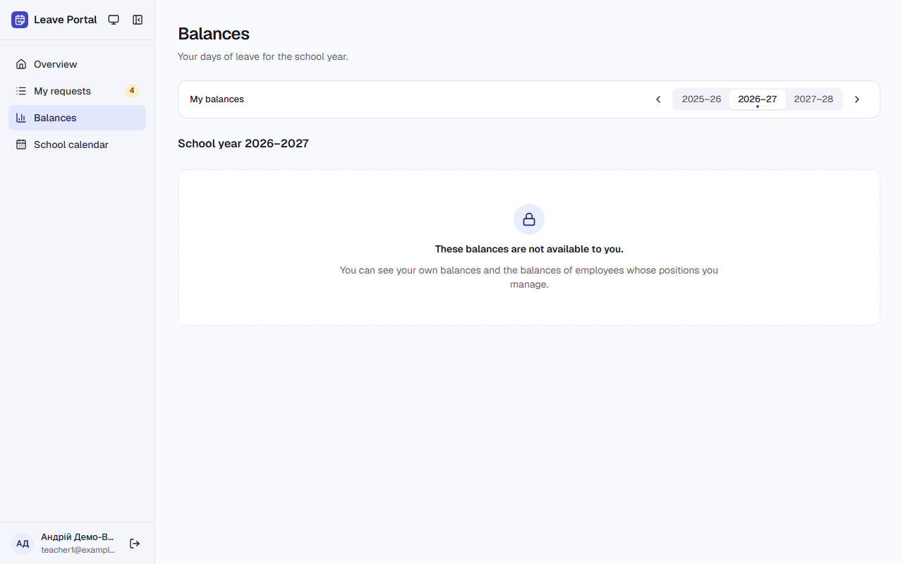

**Кроки:** ✔ Дано: employee teacher1@example.test → ✔ Коли: teacher1@example.test tries to view another employee's balances (teacher2@example.test, direct link) → ✔ Тоді: the balances are not shown.

**Агент (claude-haiku-5-5, PASS):** На кадрі видно сторінку «Balances» із заголовком «School year 2026–2027» і порожнім блоком із замком, де написано «These balances are not available to you.», без карток балансу та чисел днів. Текст збігається з критерієм посимвольно; частина про відсутність карток і чисел видна з кадру, але за правилами її перевіряють автоматично.

**Цитати агента, звірені зі сторінкою (aria):**
- «These balances are not available to you.» — є на сторінці

**Правило:** R6: перевірки, агент і цитати збігаються

**Відео:** `test-results/artifacts/balances-AC-BALANCE-13-tea-88477--the-balances-are-not-shown-chromium/video.webm` · **траса:** `test-results/artifacts/balances-AC-BALANCE-13-tea-88477--the-balances-are-not-shown-chromium/trace.zip` (не в git)

**Рішення PM:** ☐ приймаю · ☐ відхилення від вимог (issue «Відхилення від вимог: AC-BALANCE-13 — …») · @login: ____

## AC-CAL-01 — PASS

**Тест:** AC-CAL-01: the administrator adds "Winter break" for whole days 2026-12-28 – 2027-01-08 and the calendar shows it

**Критерій** (requirements/04-school-calendar.md):

> AC-CAL-01: Given the school calendar has no closures. When the administrator adds the closure "Winter break" for whole days from 2026-12-28 to 2027-01-08. Then the school calendar shows "Winter break" with the dates 2026-12-28 – 2027-01-08.

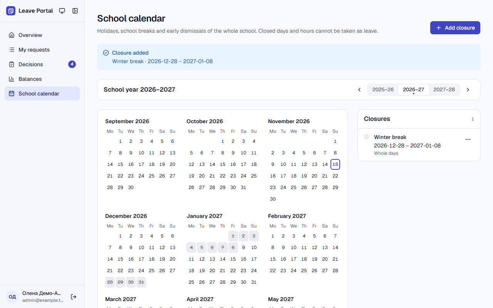

**Кроки:** ✔ Дано: the school calendar has no closures (on the dates of the AC) → ✔ Коли: the administrator adds the closure "Winter break" for whole days from 2026-12-28 to 2027-01-08 → ✔ Тоді: the school calendar shows "Winter break" with the dates 2026-12-28 – 2027-01-08.

**Агент (claude-haiku-5-5, PASS):** На кадрі видно сторінку «School calendar» з правою панеллю «Closures», де є рядок «Winter break» і дати «2026-12-28 – 2027-01-08» (позначено «Whole days»). Також у синьому банері зверху написано «Closure added» та «Winter break · 2026-12-28 – 2027-01-08». Частину «Exactly one closure» (лічильник «1») не оцінював, бо вона не з кадрів.

**Цитати агента, звірені зі сторінкою (aria):**
- «Winter break» — є на сторінці
- «2026-12-28 – 2027-01-08» — є на сторінці

**Правило:** R6: перевірки, агент і цитати збігаються

**Відео:** `test-results/artifacts/calendar-admin-example-tes-f5411-8-and-the-calendar-shows-it-chromium/video.webm` · **траса:** `test-results/artifacts/calendar-admin-example-tes-f5411-8-and-the-calendar-shows-it-chromium/trace.zip` (не в git)

**Рішення PM:** ☐ приймаю · ☐ відхилення від вимог (issue «Відхилення від вимог: AC-CAL-01 — …») · @login: ____

## AC-CAL-02 — PASS

**Тест:** AC-CAL-02: teacher1@example.test opens the school calendar and sees "Winter break" 2026-12-28 – 2027-01-08

**Критерій** (requirements/04-school-calendar.md):

> AC-CAL-02: Given the administrator added "Winter break" 2026-12-28 – 2027-01-08. When teacher1@example.test opens the school calendar. Then teacher1@example.test sees "Winter break" with the dates 2026-12-28 – 2027-01-08.

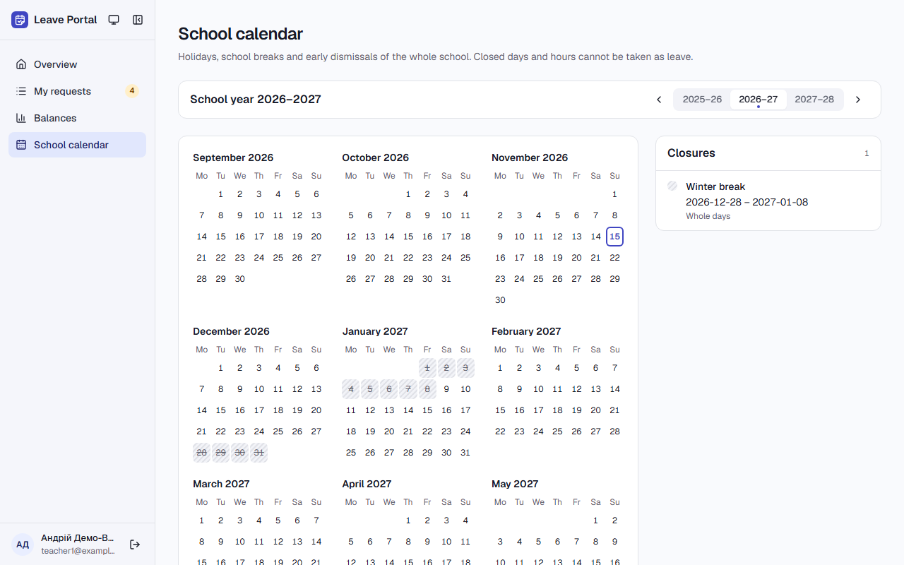

**Кроки:** ✔ Дано: the administrator added "Winter break" 2026-12-28 – 2027-01-08 → ✔ Коли: teacher1@example.test opens the school calendar → ✔ Тоді: teacher1@example.test sees "Winter break" with the dates 2026-12-28 – 2027-01-08.

**Агент (claude-haiku-5-5, PASS):** На кадрі сторінки School calendar (School year 2026–2027) у панелі Closures видно рядок «Winter break» з датами «2026-12-28 – 2027-01-08» і підписом «Whole days». У календарі на грудень 2026 та січень 2027 дні 28–31 грудня та 1–8 січня позначені як закриті, що узгоджується з рядком.

**Цитати агента, звірені зі сторінкою (aria):**
- «Winter break» — є на сторінці
- «2026-12-28 – 2027-01-08» — є на сторінці

**Правило:** R6: перевірки, агент і цитати збігаються

**Відео:** `test-results/artifacts/calendar-teacher1-example--18898-eak-2026-12-28-–-2027-01-08-chromium/video.webm` · **траса:** `test-results/artifacts/calendar-teacher1-example--18898-eak-2026-12-28-–-2027-01-08-chromium/trace.zip` (не в git)

**Рішення PM:** ☐ приймаю · ☐ відхилення від вимог (issue «Відхилення від вимог: AC-CAL-02 — …») · @login: ____

## AC-CAL-03 — PASS

**Тест:** AC-CAL-03: Tuesday 2026-12-29 in "Winter break" is not accepted — «The school is closed on this day: Winter break»

**Критерій** (requirements/04-school-calendar.md):

> AC-CAL-03: Given "Winter break" 2026-12-28 – 2027-01-08 and an employee with the schedule Mon–Fri 08:30–15:30. When the employee tries to choose Tuesday 2026-12-29 in a new request. Then the date is not accepted, and the employee sees the message "The school is closed on this day: Winter break".

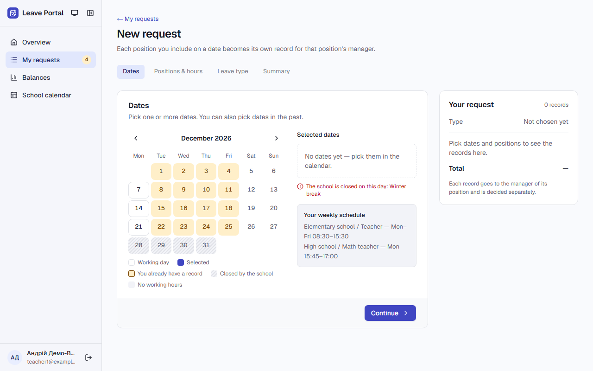

**Кроки:** ✔ Дано: "Winter break" 2026-12-28 – 2027-01-08 and an employee with the schedule Mon–Fri 08:30–15:30 → ✔ Коли: the employee tries to choose Tuesday 2026-12-29 in a new request → ✔ Тоді: the date is not accepted, and the employee sees the message "The school is closed on this day: Winter break".

**Агент (claude-haiku-5-5, PASS):** На кадрі /requests/new у календарі грудня 2026 вівторок 29 закреслений як «Closed by the school», а в блоці «Selected dates» видно «No dates yet — pick them in the calendar.». Під полем дат червоним написано «The school is closed on this day: Winter break» (перенесено на два рядки, текст читабельний). Відсутність кнопки «Remove Tue, 29 Dec 2026» на кадрі не перевірити, тому цю частину не оцінював.

**Цитати агента, звірені зі сторінкою (aria):**
- «The school is closed on this day: Winter break» — є на сторінці
- «No dates yet — pick them in the calendar.» — є на сторінці

**Правило:** R6: перевірки, агент і цитати збігаються

**Відео:** `test-results/artifacts/calendar-teacher1-example--69095-d-on-this-day-Winter-break»-chromium/video.webm` · **траса:** `test-results/artifacts/calendar-teacher1-example--69095-d-on-this-day-Winter-break»-chromium/trace.zip` (не в git)

**Рішення PM:** ☐ приймаю · ☐ відхилення від вимог (issue «Відхилення від вимог: AC-CAL-03 — …») · @login: ____

## AC-CAL-04 — PASS

**Тест:** AC-CAL-04: Personal leave for the whole day on the early dismissal 2026-11-20 — 1 record 2026-11-20 08:30–12:00

**Критерій** (requirements/04-school-calendar.md):

> AC-CAL-04: Given an early dismissal "Teachers' meeting" on Friday 2026-11-20 from 12:00 and an employee with the schedule Mon–Fri 08:30–15:30. When the employee requests "Personal leave" for the whole day 2026-11-20 and confirms the summary. Then 1 record 2026-11-20 08:30–12:00 is created.

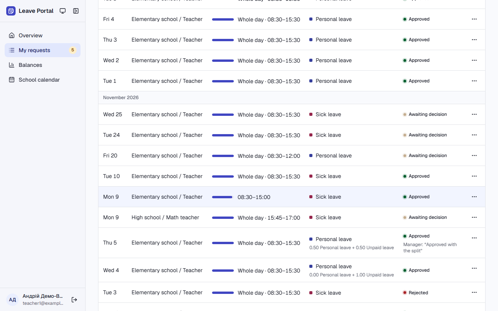

**Кроки:** ✔ Дано: an early dismissal "Teachers' meeting" on Friday 2026-11-20 from 12:00 and an employee with the schedule Mon–Fri 08:30–15:30 → ✔ Коли: the employee requests "Personal leave" for the whole day 2026-11-20 and confirms the summary → ✔ Тоді: 1 record 2026-11-20 08:30–12:00 is created.

**Агент (claude-haiku-5-5, PASS):** На кадрі в секції «November 2026» є один рядок для Fri 20 з часом «Whole day · 08:30–12:00» і типом «Personal leave». Інших рядків із датою 20 листопада на екрані немає. Слово «Whole day» — мітка типу запису, години збігаються з критерієм посимвольно.

**Цитати агента, звірені зі сторінкою (aria):**
- «Fri 20» — є на сторінці
- «Whole day · 08:30–12:00» — є на сторінці

**Правило:** R6: перевірки, агент і цитати збігаються

**Відео:** `test-results/artifacts/calendar-teacher1-example--a780b-cord-2026-11-20-08-30–12-00-chromium/video.webm` · **траса:** `test-results/artifacts/calendar-teacher1-example--a780b-cord-2026-11-20-08-30–12-00-chromium/trace.zip` (не в git)

**Рішення PM:** ☐ приймаю · ☐ відхилення від вимог (issue «Відхилення від вимог: AC-CAL-04 — …») · @login: ____

## AC-CAL-05 — PASS

**Тест:** AC-CAL-05: hours 13:00–14:00 on the early dismissal 2026-11-20 — no request, «Hours must be within your schedule: 08:30–12:00»

**Критерій** (requirements/04-school-calendar.md):

> AC-CAL-05: Given the early dismissal from AC-CAL-04 and the same employee. When the employee enters the hours 13:00–14:00 on 2026-11-20. Then no request is created, and the employee sees the message "Hours must be within your schedule: 08:30–12:00".

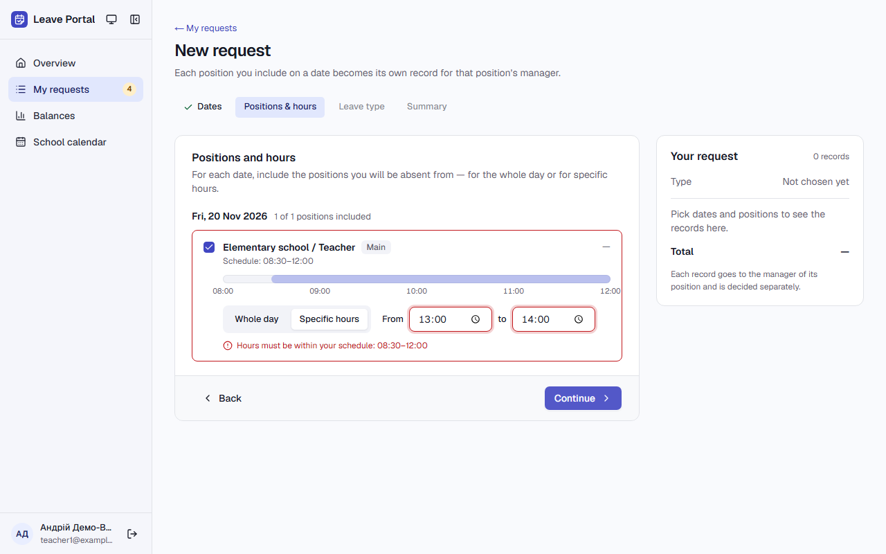

**Кроки:** ✔ Дано: the early dismissal from AC-CAL-04 and the same employee → ✔ Коли: the employee enters the hours 13:00–14:00 on 2026-11-20 → ✔ Тоді: no request is created, and the employee sees the message "Hours must be within your schedule: 08:30–12:00".

**Агент (claude-haiku-5-5, PASS):** На кадрі сторінки «New request» видно поля From 13:00 і to 14:00 для Fri, 20 Nov 2026, а під ними червоний напис «Hours must be within your schedule: 08:30–12:00». Форма залишається на кроці «Positions and hours», видно кнопку «Continue», кнопки «Submit request» немає. Факт створення заявки з кадру не видно, тому цю частину не оцінюю.

**Цитати агента, звірені зі сторінкою (aria):**
- «Hours must be within your schedule: 08:30–12:00» — є на сторінці
- «Positions and hours» — є на сторінці

**Правило:** R6: перевірки, агент і цитати збігаються

**Відео:** `test-results/artifacts/calendar-teacher1-example--73228--your-schedule-08-30–12-00»-chromium/video.webm` · **траса:** `test-results/artifacts/calendar-teacher1-example--73228--your-schedule-08-30–12-00»-chromium/trace.zip` (не в git)

**Рішення PM:** ☐ приймаю · ☐ відхилення від вимог (issue «Відхилення від вимог: AC-CAL-05 — …») · @login: ____

## AC-CAL-06 — PASS

**Тест:** AC-CAL-06: the manager approves the whole-day "Sick leave" 2026-11-20 08:30–12:00 — balances show "Sick leave" used 1.00, not 0.50

**Критерій** (requirements/04-school-calendar.md):

> AC-CAL-06: Given the early dismissal from AC-CAL-04, an employee with a single position (schedule Fri 08:30–15:30) and "Sick leave" used 0.00. When the manager approves the whole-day "Sick leave" record 2026-11-20 08:30–12:00. Then the employee's balances show "Sick leave" used 1.00 (210 of 210 working minutes that day), not 0.50.

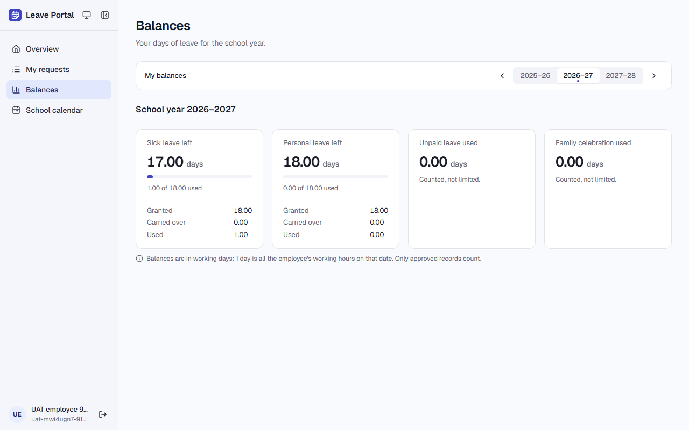

**Кроки:** ✔ Дано: the early dismissal from AC-CAL-04, an employee with a single position (schedule Fri 08:30–15:30) and "Sick leave" used 0.00 → ✔ Коли: the manager approves the whole-day "Sick leave" record 2026-11-20 08:30–12:00 → ✔ Тоді: the employee's balances show "Sick leave" used 1.00 (210 of 210 working minutes that day), not 0.50.

**Агент (claude-haiku-5-5, PASS):** На кадрі сторінки /balances картка «Sick leave left» показує «17.00 days», а під шкалою написано «1.00 of 18.00 used»; у рядку «Used» також стоїть 1.00. «…» у критерії означає загальну кількість днів, тому цитата «1.00 of 18.00 used» відповідає частині «Тоді». Частини про початковий стан (0.00) і 210 з 210 хвилин не видно на кадрі, тому їх не оцінено.

**Цитати агента, звірені зі сторінкою (aria):**
- «Sick leave left» — є на сторінці
- «1.00 of 18.00 used» — є на сторінці

**Правило:** R6: перевірки, агент і цитати збігаються

**Відео:** `test-results/artifacts/calendar-manager1-example--ee997-ck-leave-used-1-00-not-0-50-chromium/video.webm` · **траса:** `test-results/artifacts/calendar-manager1-example--ee997-ck-leave-used-1-00-not-0-50-chromium/trace.zip` (не в git)

**Рішення PM:** ☐ приймаю · ☐ відхилення від вимог (issue «Відхилення від вимог: AC-CAL-06 — …») · @login: ____

## AC-CAL-07 — PASS

**Тест:** AC-CAL-07: teacher1@example.test's Approved record on 2026-12-29 — "Winter break" is not saved, the message lists the record

**Критерій** (requirements/04-school-calendar.md):

> AC-CAL-07: Given teacher1@example.test has a record 2026-12-29 08:30–15:30 with status "Approved". When the administrator tries to add "Winter break" from 2026-12-28 to 2027-01-08. Then the closure is not saved, the school calendar has no "Winter break", and the administrator sees the message "These days have leave records and cannot be closed: 2026-12-29 teacher1@example.test".

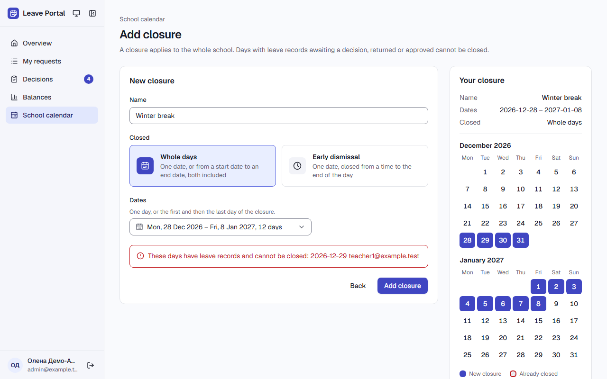

**Кроки:** ✔ Дано: teacher1@example.test has a record 2026-12-29 08:30–15:30 with status "Approved" → ✔ Коли: the administrator tries to add "Winter break" from 2026-12-28 to 2027-01-08 → ✔ Тоді: the closure is not saved, the school calendar has no "Winter break", and the administrator sees the message "These days have leave records and cannot be closed: 2026-12-29 teacher1@example.test".

**Агент (claude-haiku-5-5, PASS):** На кадрі видно сторінку «Add closure» з полем Name «Winter break», діапазон 28 Dec 2026 – 8 Jan 2027, і червоне повідомлення з текстом, який збігається з критерієм посимвольно. URL на кадрі не видно, тож шлях /calendar/manage не перевірено; це не входить до видимих частин «Тоді». Частину «school calendar has no Winter break» не оцінював, бо вона з розділу «Не з кадрів».

**Цитати агента, звірені зі сторінкою (aria):**
- «These days have leave records and cannot be closed: 2026-12-29 teacher1@example.test» — є на сторінці
- «Add closure» — є на сторінці
- «Winter break» — є на сторінці

**Правило:** R6: перевірки, агент і цитати збігаються

**Відео:** `test-results/artifacts/calendar-admin-example-tes-975ac-he-message-lists-the-record-chromium/video.webm` · **траса:** `test-results/artifacts/calendar-admin-example-tes-975ac-he-message-lists-the-record-chromium/trace.zip` (не в git)

**Рішення PM:** ☐ приймаю · ☐ відхилення від вимог (issue «Відхилення від вимог: AC-CAL-07 — …») · @login: ____

## AC-CAL-08 — PASS

**Тест:** AC-CAL-08: the only record on 2026-12-29 is Rejected — "Winter break" is saved and shown

**Критерій** (requirements/04-school-calendar.md):

> AC-CAL-08: Given the only record on 2026-12-29 has status "Rejected". When the administrator adds "Winter break" from 2026-12-28 to 2027-01-08. Then the closure is saved, and the school calendar shows "Winter break" with the dates 2026-12-28 – 2027-01-08.

**Кроки:** ✔ Дано: the only record on 2026-12-29 has status "Rejected" → ✔ Коли: the administrator adds "Winter break" from 2026-12-28 to 2027-01-08 → ✔ Тоді: the closure is saved, and the school calendar shows "Winter break" with the dates 2026-12-28 – 2027-01-08.

**Агент (claude-haiku-5-5, PASS):** На кадрі /calendar (School calendar) видно синє повідомлення «Closure added» з рядком «Winter break · 2026-12-28 – 2027-01-08». У панелі «Closures» (лічильник 1) є запис «Winter break» з датами «2026-12-28 – 2027-01-08» і позначкою «Whole days». Обидві видимі частини «Тоді» збігаються з критерієм.

**Цитати агента, звірені зі сторінкою (aria):**
- «Closure added» — є на сторінці
- «Winter break» — є на сторінці
- «2026-12-28 – 2027-01-08» — є на сторінці

**Правило:** R6: перевірки, агент і цитати збігаються

**Відео:** `test-results/artifacts/calendar-admin-example-tes-eb789-er-break-is-saved-and-shown-chromium/video.webm` · **траса:** `test-results/artifacts/calendar-admin-example-tes-eb789-er-break-is-saved-and-shown-chromium/trace.zip` (не в git)

**Рішення PM:** ☐ приймаю · ☐ відхилення від вимог (issue «Відхилення від вимог: AC-CAL-08 — …») · @login: ____

## AC-CAL-09 — PASS

**Тест:** AC-CAL-09: after the administrator removes "Winter break", Tuesday 2026-12-29 is accepted with the hours 08:30–15:30

**Критерій** (requirements/04-school-calendar.md):

> AC-CAL-09: Given "Winter break" 2026-12-28 – 2027-01-08 and an employee with the schedule Mon–Fri 08:30–15:30. When the administrator removes "Winter break" and the employee then chooses Tuesday 2026-12-29 in a new request. Then the school calendar no longer shows "Winter break", and 2026-12-29 is accepted with the hours 08:30–15:30.

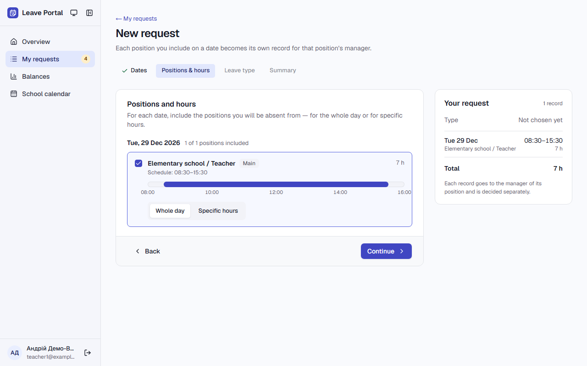

**Кроки:** ✔ Дано: "Winter break" 2026-12-28 – 2027-01-08 and an employee with the schedule Mon–Fri 08:30–15:30 → ✔ Коли: the administrator removes "Winter break" and the employee then chooses Tuesday 2026-12-29 in a new request → ✔ Тоді: the school calendar no longer shows "Winter break", and 2026-12-29 is accepted with the hours 08:30–15:30.

**Агент (claude-haiku-5-5, PASS):** На кадрі сторінка «New request» з кроком «Positions and hours» (заголовок картки; у верхній вкладці написано «Positions & hours»). Для «Tue, 29 Dec 2026» видно «1 of 1 positions included» і Elementary school / Teacher з «Schedule: 08:30–15:30», активна кнопка «Whole day», а в правій колонці «Tue 29 Dec 08:30–15:30». Пункт «Not from frames» (календар без «Winter break») не оцінювався.

**Цитати агента, звірені зі сторінкою (aria):**
- «Positions and hours» — є на сторінці
- «Tue, 29 Dec 2026» — є на сторінці
- «Schedule: 08:30–15:30» — є на сторінці
- «Whole day» — є на сторінці

**Правило:** R6: перевірки, агент і цитати збігаються

**Відео:** `test-results/artifacts/calendar-teacher1-example--95f0c--with-the-hours-08-30–15-30-chromium/video.webm` · **траса:** `test-results/artifacts/calendar-teacher1-example--95f0c--with-the-hours-08-30–15-30-chromium/trace.zip` (не в git)

**Рішення PM:** ☐ приймаю · ☐ відхилення від вимог (issue «Відхилення від вимог: AC-CAL-09 — …») · @login: ____

## AC-CAL-10 — PASS

**Тест:** AC-CAL-10: an end date 2026-12-28 before the start date 2027-01-08 — not saved, «The end date cannot be earlier than the start date»

**Критерій** (requirements/04-school-calendar.md):

> AC-CAL-10: Given the administrator adds a closure. When the administrator enters the start date 2027-01-08 and the end date 2026-12-28. Then the closure is not saved, and the administrator sees the message "The end date cannot be earlier than the start date".

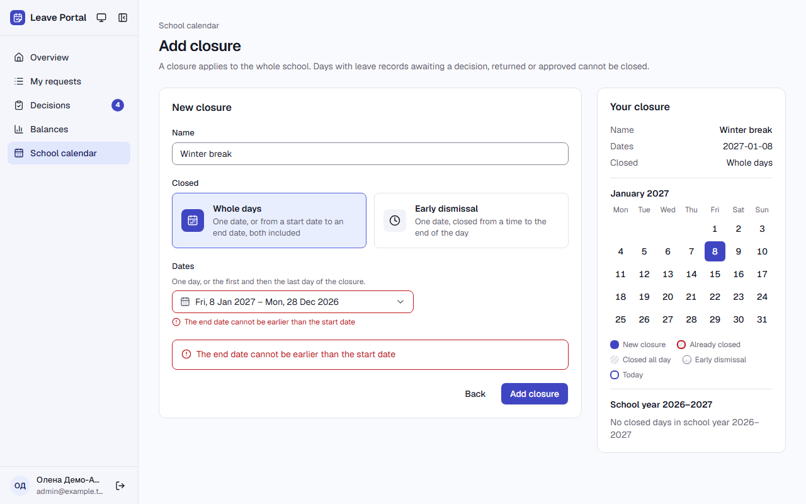

**Кроки:** ✔ Дано: the administrator adds a closure → ✔ Коли: the administrator enters the start date 2027-01-08 and the end date 2026-12-28 → ✔ Тоді: the closure is not saved, and the administrator sees the message "The end date cannot be earlier than the start date".

**Агент (claude-haiku-5-5, PASS):** На кадрі сторінка «Add closure» з полем дат «Fri, 8 Jan 2027 – Mon, 28 Dec 2026» і червоним повідомленням «The end date cannot be earlier than the start date» — воно є двічі: під полем дат і в окремому блоці з помилкою. Текст збігається з критерієм посимвольно. Частини «Не з кадрів» (збережені дати у формі, відсутність «Winter break» у календарі) не оцінювалися.

**Цитати агента, звірені зі сторінкою (aria):**
- «The end date cannot be earlier than the start date» — є на сторінці

**Правило:** R6: перевірки, агент і цитати збігаються

**Відео:** `test-results/artifacts/calendar-admin-example-tes-8153d-arlier-than-the-start-date»-chromium/video.webm` · **траса:** `test-results/artifacts/calendar-admin-example-tes-8153d-arlier-than-the-start-date»-chromium/trace.zip` (не в git)

**Рішення PM:** ☐ приймаю · ☐ відхилення від вимог (issue «Відхилення від вимог: AC-CAL-10 — …») · @login: ____

## AC-CAL-11 — PASS

**Тест:** AC-CAL-11: "Staff day" on 2026-12-30 inside "Winter break" — not saved, «2026-12-30 is already closed: Winter break»

**Критерій** (requirements/04-school-calendar.md):

> AC-CAL-11: Given "Winter break" 2026-12-28 – 2027-01-08. When the administrator tries to add the closure "Staff day" for 2026-12-30. Then the closure is not saved, and the administrator sees the message "2026-12-30 is already closed: Winter break".

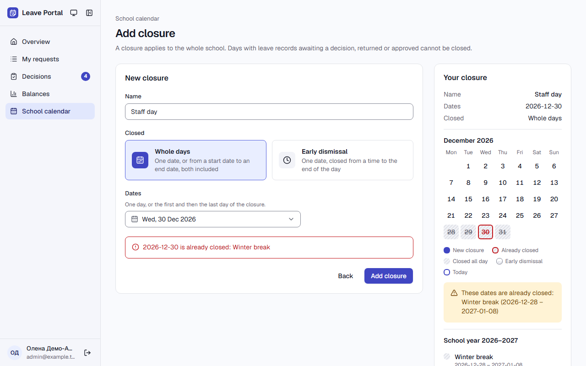

**Кроки:** ✔ Дано: "Winter break" 2026-12-28 – 2027-01-08 → ✔ Коли: the administrator tries to add the closure "Staff day" for 2026-12-30 → ✔ Тоді: the closure is not saved, and the administrator sees the message "2026-12-30 is already closed: Winter break".

**Агент (claude-haiku-5-5, PASS):** На кадрі сторінки /calendar/manage (Add closure) під полем дат червоним написано «2026-12-30 is already closed: Winter break», текст повністю збігається з критерієм. Частина про те, що закриття не збережено, не видима на кадрі й оцінена як cannot-tell.

**Цитати агента, звірені зі сторінкою (aria):**
- «2026-12-30 is already closed: Winter break» — є на сторінці

**Правило:** R6: перевірки, агент і цитати збігаються

**Відео:** `test-results/artifacts/calendar-admin-example-tes-f825e-lready-closed-Winter-break»-chromium/video.webm` · **траса:** `test-results/artifacts/calendar-admin-example-tes-f825e-lready-closed-Winter-break»-chromium/trace.zip` (не в git)

**Рішення PM:** ☐ приймаю · ☐ відхилення від вимог (issue «Відхилення від вимог: AC-CAL-11 — …») · @login: ____

## AC-CAL-12 — PASS

**Тест:** AC-CAL-12: teacher1@example.test opens the page for changing the school calendar — «Only an administrator can change the school calendar»

**Критерій** (requirements/04-school-calendar.md):

> AC-CAL-12: Given teacher1@example.test is signed in and has only the employee role. When teacher1@example.test opens the page for changing the school calendar by a direct link. Then teacher1@example.test sees the message "Only an administrator can change the school calendar", and the school calendar is unchanged.

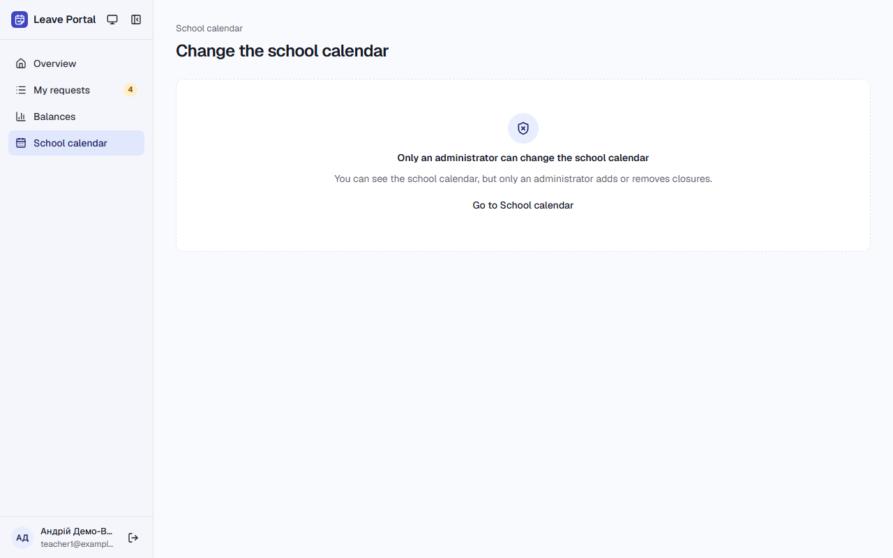

**Кроки:** ✔ Дано: teacher1@example.test is signed in and has only the employee role → ✔ Коли: teacher1@example.test opens the page for changing the school calendar by a direct link → ✔ Тоді: teacher1@example.test sees the message "Only an administrator can change the school calendar", and the school calendar is unchanged.

**Агент (claude-sonnet-5-5, PASS):** На кадрі сторінка «Change the school calendar» з повідомленням «Only an administrator can change the school calendar» і кнопкою «Go to School calendar». Жодних полів чи форми додавання закриття не видно.

Haiku сказав NEEDS-HUMAN, тож розбір повторив Sonnet; рішення агента — за Sonnet.

**Цитати агента, звірені зі сторінкою (aria):**
- «Only an administrator can change the school calendar» — є на сторінці
- «You can see the school calendar, but only an administrator adds or removes closures.» — є на сторінці

**Правило:** R6: перевірки, агент і цитати збігаються

**Відео:** `test-results/artifacts/calendar-teacher1-example--4d345-change-the-school-calendar»-chromium/video.webm` · **траса:** `test-results/artifacts/calendar-teacher1-example--4d345-change-the-school-calendar»-chromium/trace.zip` (не в git)

**Рішення PM:** ☐ приймаю · ☐ відхилення від вимог (issue «Відхилення від вимог: AC-CAL-12 — …») · @login: ____

## AC-CAL-13 — PASS

**Тест:** AC-CAL-13: manager1@example.test tries to close 2026-11-27 directly — the calendar is unchanged and 2026-11-27 is still accepted

**Критерій** (requirements/04-school-calendar.md):

> AC-CAL-13: Given manager1@example.test is signed in and is not an administrator. When manager1@example.test tries to close 2026-11-27 directly, bypassing the portal's pages. Then the school calendar is unchanged, and 2026-11-27 is still accepted in a new request.

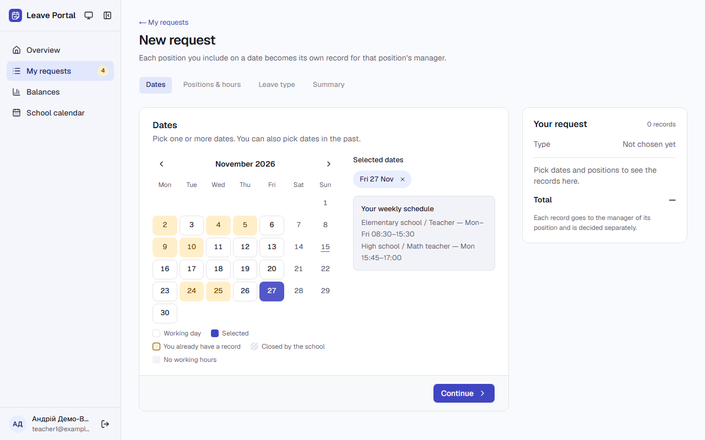

**Кроки:** ✔ Дано: manager1@example.test is signed in and is not an administrator → ✔ Коли: manager1@example.test tries to close 2026-11-27 directly, bypassing the portal's pages → ✔ Тоді: the school calendar is unchanged, and 2026-11-27 is still accepted in a new request.

**Агент (claude-sonnet-5-5, PASS):** На сторінці New request у календарі листопада 2026 дата 27 виділена як вибрана, а під «Selected dates» є чіп «Fri 27 Nov». Тобто 27 листопада у новому запиті приймається. Частини «Не з кадрів» не оцінювались.

Haiku сказав NEEDS-HUMAN, тож розбір повторив Sonnet; рішення агента — за Sonnet.

**Цитати агента, звірені зі сторінкою (aria):**
- «Selected dates» — є на сторінці
- «Fri 27 Nov» — є на сторінці

**Правило:** R6: перевірки, агент і цитати збігаються

**Відео:** `test-results/artifacts/calendar-manager1-example--2051b-026-11-27-is-still-accepted-chromium/video.webm` · **траса:** `test-results/artifacts/calendar-manager1-example--2051b-026-11-27-is-still-accepted-chromium/trace.zip` (не в git)

**Рішення PM:** ☐ приймаю · ☐ відхилення від вимог (issue «Відхилення від вимог: AC-CAL-13 — …») · @login: ____

## AC-CAL-14 — PASS

**Тест:** AC-CAL-14: a visitor who is not signed in opens the school calendar by a direct link — the sign-in page, no closure names or dates

**Критерій** (requirements/04-school-calendar.md):

> AC-CAL-14: Given nobody is signed in. When a visitor opens the school calendar by a direct link. Then the visitor sees the sign-in page, and no closure names or dates are shown.

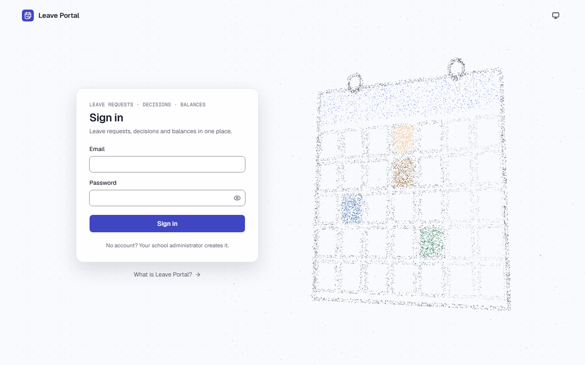

**Кроки:** ✔ Дано: nobody is signed in (and the school calendar has a closure, so there is something to hide) → ✔ Коли: a visitor opens the school calendar by a direct link → ✔ Тоді: the visitor sees the sign-in page, and no closure names or dates are shown.

**Агент (claude-haiku-5-5, PASS):** На кадрі видно сторінку входу «Sign in» з полями «Email» і «Password» та кнопкою «Sign in», заголовок і підпис читаються. Навчального календаря з назвами чи датами канікул на кадрі немає; перевірка відсутності «Winter break» і «2026-12-28» не з кадрів, тому її не оцінюю.

**Цитати агента, звірені зі сторінкою (aria):**
- «Email» — є на сторінці
- «Password» — є на сторінці
- «Sign in» — є на сторінці

**Правило:** R6: перевірки, агент і цитати збігаються

**Відео:** `test-results/artifacts/calendar-AC-CAL-14-a-visit-8a3ad-e-no-closure-names-or-dates-chromium/video.webm` · **траса:** `test-results/artifacts/calendar-AC-CAL-14-a-visit-8a3ad-e-no-closure-names-or-dates-chromium/trace.zip` (не в git)

**Рішення PM:** ☐ приймаю · ☐ відхилення від вимог (issue «Відхилення від вимог: AC-CAL-14 — …») · @login: ____

## AC-CAL-15 — PASS

**Тест:** AC-CAL-15: no closures in school year 2026–2027 — «No closed days in school year 2026–2027»

**Критерій** (requirements/04-school-calendar.md):

> AC-CAL-15: Given the school calendar has no closures in school year 2026–2027. When an employee opens the school calendar for school year 2026–2027. Then the employee sees the message "No closed days in school year 2026–2027".

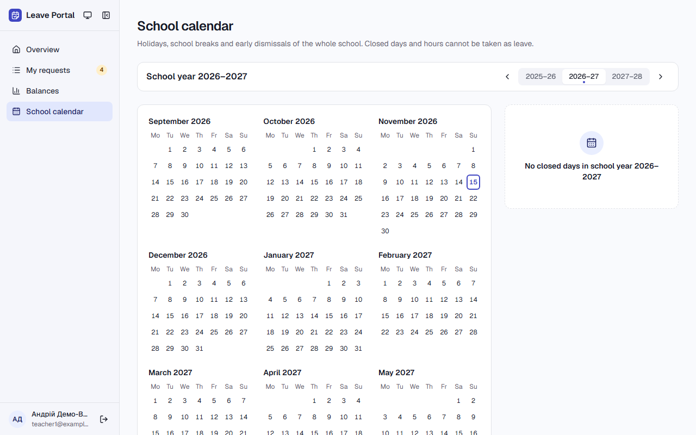

**Кроки:** ✔ Дано: the school calendar has no closures in school year 2026–2027 → ✔ Коли: an employee opens the school calendar for school year 2026–2027 → ✔ Тоді: the employee sees the message "No closed days in school year 2026–2027".

**Агент (claude-haiku-5-5, PASS):** На кадрі сторінки School calendar з вибраним «School year 2026–2027» у правій панелі видно повідомлення «No closed days in school year 2026–2027», яке перенесено на два рядки («2026–» / «2027»); текст і тире відповідають критерію. Відсутність рядків закриттів не з кадрів, тому не оцінювалась.

**Цитати агента, звірені зі сторінкою (aria):**
- «No closed days in school year 2026–2027» — є на сторінці

**Правило:** R6: перевірки, агент і цитати збігаються

**Відео:** `test-results/artifacts/calendar-teacher1-example--18069-s-in-school-year-2026–2027»-chromium/video.webm` · **траса:** `test-results/artifacts/calendar-teacher1-example--18069-s-in-school-year-2026–2027»-chromium/trace.zip` (не в git)

**Рішення PM:** ☐ приймаю · ☐ відхилення від вимог (issue «Відхилення від вимог: AC-CAL-15 — …») · @login: ____

## AC-CAL-16 — PASS

**Тест:** AC-CAL-16: the early dismissal from 12:00 leaves no working time on 2026-11-20 — «The school is closed on this day: Teachers' meeting»

**Критерій** (requirements/04-school-calendar.md):

> AC-CAL-16: Given an early dismissal "Teachers' meeting" on Friday 2026-11-20 from 12:00 and an employee whose only schedule block that Friday is 13:00–17:00. When the employee tries to choose 2026-11-20 in a new request. Then the date is not accepted, and the employee sees the message "The school is closed on this day: Teachers' meeting".

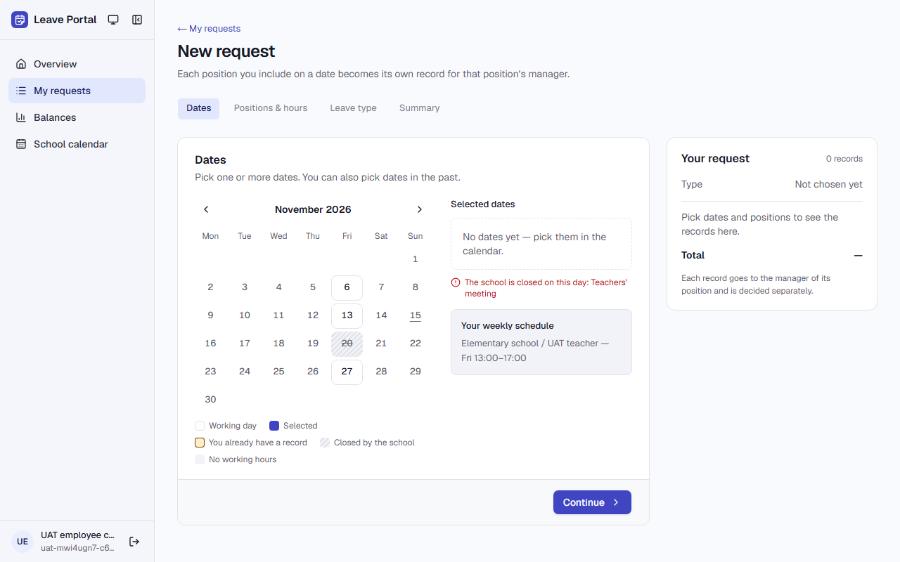

**Кроки:** ✔ Дано: an early dismissal "Teachers' meeting" on Friday 2026-11-20 from 12:00 and an employee whose only schedule block that Friday is 13:00–17:00 → ✔ Коли: the employee tries to choose 2026-11-20 in a new request → ✔ Тоді: the date is not accepted, and the employee sees the message "The school is closed on this day: Teachers' meeting".

**Агент (claude-haiku-5-5, PASS):** На кадрі сторінки /requests/new у календарі п’ятниця 20 Nov 2026 позначена як «Closed by the school» (штрихування), а в блоці «Selected dates» видно «No dates yet — pick them in the calendar.». Під полем дат червоним написано «The school is closed on this day: Teachers' meeting», текст перенесено на два рядки, але послідовність слів збігається з критерієм. Апостроф у «Teachers'» на кадрі виглядає як звичайний, але роздільна здатність не дає перевірити його тип на 100%.

**Цитати агента, звірені зі сторінкою (aria):**
- «The school is closed on this day: Teachers' meeting» — є на сторінці
- «No dates yet — pick them in the calendar.» — є на сторінці

**Правило:** R6: перевірки, агент і цитати збігаються

**Відео:** `test-results/artifacts/calendar-an-employee-whose-38b6d--this-day-Teachers-meeting»-chromium/video.webm` · **траса:** `test-results/artifacts/calendar-an-employee-whose-38b6d--this-day-Teachers-meeting»-chromium/trace.zip` (не в git)

**Рішення PM:** ☐ приймаю · ☐ відхилення від вимог (issue «Відхилення від вимог: AC-CAL-16 — …») · @login: ____

## AC-CAL-17 — PASS

**Тест:** AC-CAL-17: "Extra break" 2027-01-05 – 2027-01-15 over "Winter break" and "Staff day" — not saved, one message part per closure

**Критерій** (requirements/04-school-calendar.md):

> AC-CAL-17: Given "Winter break" 2026-12-28 – 2027-01-08 and "Staff day" 2027-01-12. When the administrator tries to add "Extra break" from 2027-01-05 to 2027-01-15. Then the closure is not saved, and the administrator sees the message "2027-01-05 is already closed: Winter break, 2027-01-12 is already closed: Staff day".

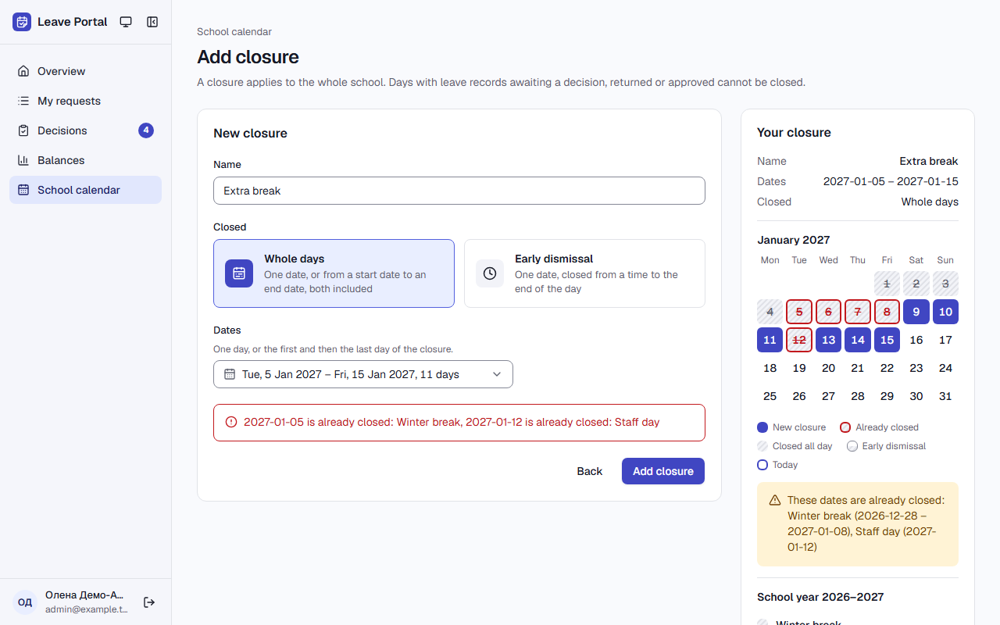

**Кроки:** ✔ Дано: "Winter break" 2026-12-28 – 2027-01-08 and "Staff day" 2027-01-12 → ✔ Коли: the administrator tries to add "Extra break" from 2027-01-05 to 2027-01-15 → ✔ Тоді: the closure is not saved, and the administrator sees the message "2027-01-05 is already closed: Winter break, 2027-01-12 is already closed: Staff day".

**Агент (claude-haiku-5-5, PASS):** На кадрі frame-then-1.png (сторінка Add closure / School calendar) під полем «Dates» видно червоне повідомлення, яке збігається з критерієм посимвольно. Форма ще відкрита з введеною назвою «Extra break», але це не суперечить «Тоді»; факт незбереження перевіряється не з кадру.

**Цитати агента, звірені зі сторінкою (aria):**
- «2027-01-05 is already closed: Winter break, 2027-01-12 is already closed: Staff day» — є на сторінці

**Правило:** R6: перевірки, агент і цитати збігаються

**Відео:** `test-results/artifacts/calendar-admin-example-tes-d9e81-ne-message-part-per-closure-chromium/video.webm` · **траса:** `test-results/artifacts/calendar-admin-example-tes-d9e81-ne-message-part-per-closure-chromium/trace.zip` (не в git)

**Рішення PM:** ☐ приймаю · ☐ відхилення від вимог (issue «Відхилення від вимог: AC-CAL-17 — …») · @login: ____

## AC-CAL-18 — PASS

**Тест:** AC-CAL-18: the administrator leaves the name empty for 2027-01-20 — not saved, «Enter a name for the closure»

**Критерій** (requirements/04-school-calendar.md):

> AC-CAL-18: Given the administrator adds a closure for 2027-01-20. When the administrator leaves the name empty and tries to save. Then the closure is not saved, and the administrator sees the message "Enter a name for the closure".

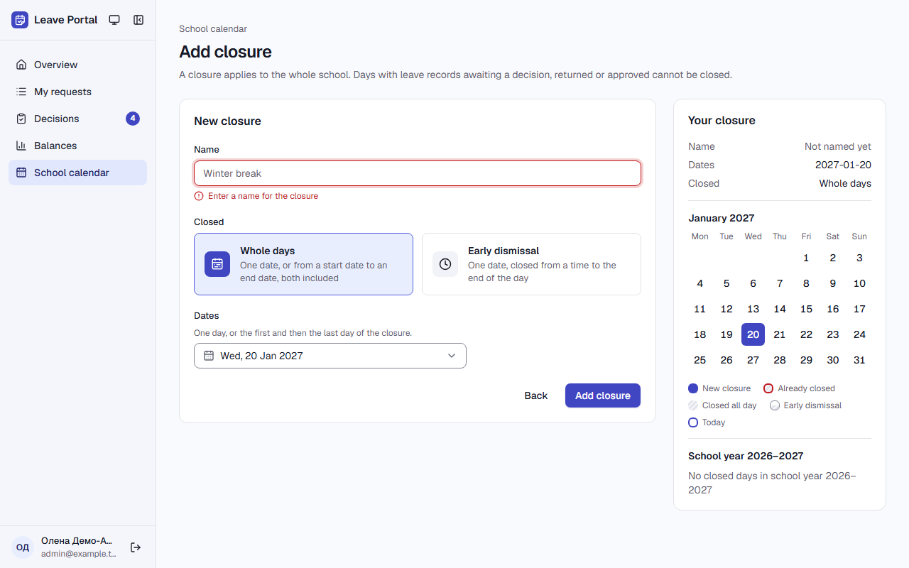

**Кроки:** ✔ Дано: the administrator adds a closure for 2027-01-20 → ✔ Коли: the administrator leaves the name empty and tries to save → ✔ Тоді: the closure is not saved, and the administrator sees the message "Enter a name for the closure".

**Агент (claude-haiku-5-5, PASS):** На кадрі сторінка /calendar/manage з формою «Add closure», поле Name порожнє й підсвічене червоною рамкою. Під полем видно червоний напис «Enter a name for the closure», посимвольно збіжний із критерієм. Дата 20 Jan 2027 вибрана, форма не покинута.

**Цитати агента, звірені зі сторінкою (aria):**
- «Enter a name for the closure» — є на сторінці

**Правило:** R6: перевірки, агент і цитати збігаються

**Відео:** `test-results/artifacts/calendar-admin-example-tes-9fbb6-ter-a-name-for-the-closure»-chromium/video.webm` · **траса:** `test-results/artifacts/calendar-admin-example-tes-9fbb6-ter-a-name-for-the-closure»-chromium/trace.zip` (не в git)

**Рішення PM:** ☐ приймаю · ☐ відхилення від вимог (issue «Відхилення від вимог: AC-CAL-18 — …») · @login: ____

## AC-CAL-19 — PASS

**Тест:** AC-CAL-19: a name of 101 characters for 2027-01-20 — not saved, «The name can be at most 100 characters»

**Критерій** (requirements/04-school-calendar.md):

> AC-CAL-19: Given the administrator adds a closure for 2027-01-20. When the administrator enters a name of 101 characters and tries to save. Then the closure is not saved, and the administrator sees the message "The name can be at most 100 characters".

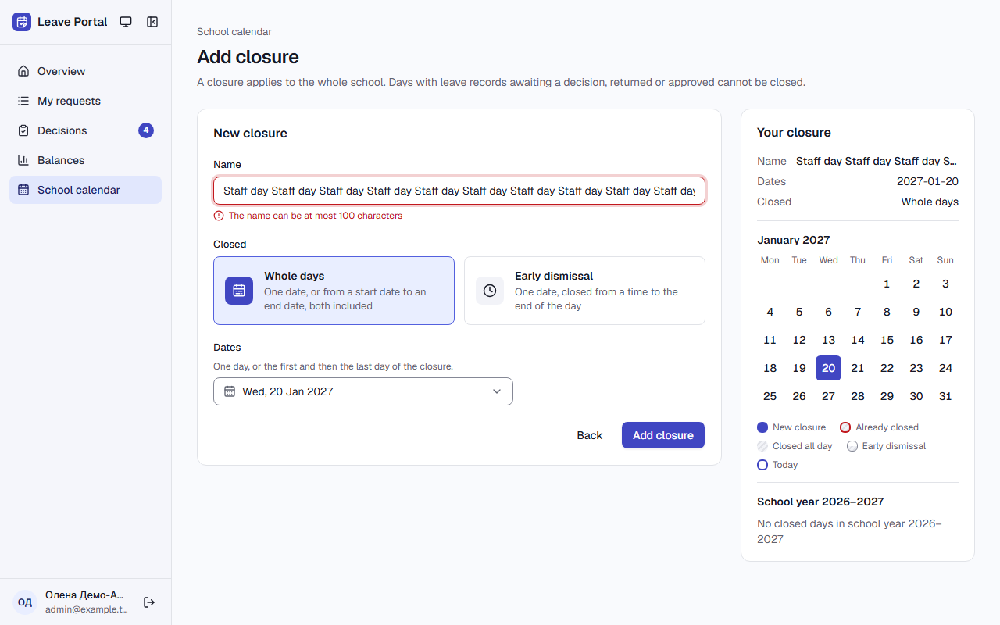

**Кроки:** ✔ Дано: the administrator adds a closure for 2027-01-20 → ✔ Коли: the administrator enters a name of 101 characters and tries to save → ✔ Тоді: the closure is not saved, and the administrator sees the message "The name can be at most 100 characters".

**Агент (claude-haiku-5-5, PASS):** На кадрі видно форму «Add closure» з полем Name, заповненим довгим текстом «Staff day…», і червоним повідомленням під полем «The name can be at most 100 characters», що повністю збігається з критерієм. Дата 2027-01-20 відображається у формі та в панелі «Your closure», тож кадр відповідає сценарію. Частини про збереження тексту та відсутність виходу зі сторінки не видно з кадру, тому їх не оцінено.

**Цитати агента, звірені зі сторінкою (aria):**
- «The name can be at most 100 characters» — є на сторінці

**Правило:** R6: перевірки, агент і цитати збігаються

**Відео:** `test-results/artifacts/calendar-admin-example-tes-0c6a6--be-at-most-100-characters»-chromium/video.webm` · **траса:** `test-results/artifacts/calendar-admin-example-tes-0c6a6--be-at-most-100-characters»-chromium/trace.zip` (не в git)

**Рішення PM:** ☐ приймаю · ☐ відхилення від вимог (issue «Відхилення від вимог: AC-CAL-19 — …») · @login: ____

## AC-CAL-20 — PASS

**Тест:** AC-CAL-20: an approved "Sick leave" 2026-11-20 08:30–11:00 (0.36) — after the early dismissal from 12:00 balances still show used 0.36

**Критерій** (requirements/04-school-calendar.md):

> AC-CAL-20: Given an employee with a single position (schedule Fri 08:30–15:30) and an approved "Sick leave" record 2026-11-20 08:30–11:00 counted as used 0.36 (150 of 420 minutes). When the administrator adds the early dismissal "Teachers' meeting" on 2026-11-20 from 12:00. Then the employee's balances still show "Sick leave" used 0.36.

**Кроки:** ✔ Дано: an employee with a single position (schedule Fri 08:30–15:30) and an approved "Sick leave" record 2026-11-20 08:30–11:00 counted as used 0.36 (150 of 420 minutes) → ✔ Коли: the administrator adds the early dismissal "Teachers' meeting" on 2026-11-20 from 12:00 → ✔ Тоді: the employee's balances still show "Sick leave" used 0.36.

**Агент (claude-haiku-5-5, PASS):** На кадрі сторінки /balances картка «Sick leave left» показує 17.64 days, а під прогресом — «0.36 of 18.00 used»; у таблиці нижче «Used 0.36». Кадр повністю читабельний, без завантаження й обрізання. У критерії «…» позначає знаменник, який на екрані дорівнює 18.00, тож частина «Тоді» виконана.

**Цитати агента, звірені зі сторінкою (aria):**
- «Sick leave left» — є на сторінці
- «0.36 of 18.00 used» — є на сторінці

**Правило:** R6: перевірки, агент і цитати збігаються

**Відео:** `test-results/artifacts/calendar-admin-example-tes-26dae-lances-still-show-used-0-36-chromium/video.webm` · **траса:** `test-results/artifacts/calendar-admin-example-tes-26dae-lances-still-show-used-0-36-chromium/trace.zip` (не в git)

**Рішення PM:** ☐ приймаю · ☐ відхилення від вимог (issue «Відхилення від вимог: AC-CAL-20 — …») · @login: ____

## AC-LEAVE-06 — PASS

**Тест:** AC-LEAVE-06: Saturday 2026-11-07 is not accepted — «You have no working hours on this day»

**Критерій** (requirements/01-leave-request.md):

> AC-LEAVE-06: Given an employee whose position has no Saturday in its schedule. When the employee tries to choose Saturday 2026-11-07. Then the date is not accepted, and the employee sees the message "You have no working hours on this day".

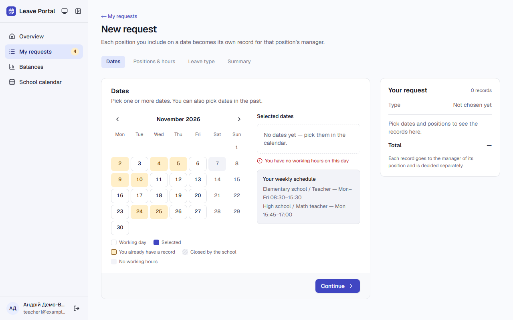

**Кроки:** ✔ Дано: an employee whose position has no Saturday in its schedule (teacher1@example.test) → ✔ Коли: the employee tries to choose Saturday 2026-11-07 → ✔ Тоді: the date is not accepted, and the employee sees the message "You have no working hours on this day".

**Агент (claude-haiku-5-5, PASS):** На кадрі frame-then-1.png під календарем червоним написано «You have no working hours on this day», а блок «Selected dates» показує «No dates yet — pick them in the calendar.». Субота 7 листопада сіра з позначкою «No working hours» і не вибрана; кнопки «Remove Sat, 7 Nov 2026» немає. Обидві видимі частини «Тоді» підтверджено посимвольно.

**Цитати агента, звірені зі сторінкою (aria):**
- «You have no working hours on this day» — є на сторінці
- «No dates yet — pick them in the calendar.» — є на сторінці

**Правило:** R6: перевірки, агент і цитати збігаються

**Відео:** `test-results/artifacts/new-request-teacher1-examp-a4f9c--working-hours-on-this-day»-chromium/video.webm` · **траса:** `test-results/artifacts/new-request-teacher1-examp-a4f9c--working-hours-on-this-day»-chromium/trace.zip` (не в git)

**Рішення PM:** ☐ приймаю · ☐ відхилення від вимог (issue «Відхилення від вимог: AC-LEAVE-06 — …») · @login: ____

## AC-LEAVE-19 — PASS

**Тест:** AC-LEAVE-19: hours 07:30–09:00 on Tue 2026-11-03 — no request, «Hours must be within your schedule: 08:30–12:00, 12:30–15:30»

**Критерій** (requirements/01-leave-request.md):

> AC-LEAVE-19: Given a position with the schedule blocks Tue 08:30–12:00 and 12:30–15:30. When the employee enters the hours 07:30–09:00 on 2026-11-03. Then no request is created, and the employee sees the message "Hours must be within your schedule: 08:30–12:00, 12:30–15:30".

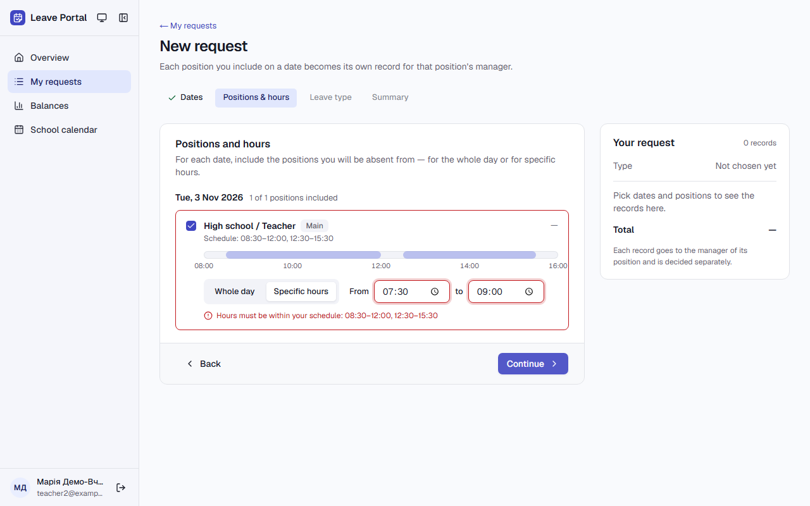

**Кроки:** ✔ Дано: a position with the schedule blocks Tue 08:30–12:00 and 12:30–15:30 (teacher2@example.test) → ✔ Коли: the employee enters the hours 07:30–09:00 on 2026-11-03 → ✔ Тоді: no request is created, and the employee sees the message "Hours must be within your schedule: 08:30–12:00, 12:30–15:30".

**Агент (claude-haiku-5-5, PASS):** На кадрі під полем «to 09:00» (From 07:30) видно червоне повідомлення з текстом, який збігається з критерієм. Форма лишається на кроці з заголовком «Positions and hours», видно кнопку «Continue», кнопки «Submit request» немає. Символи тире на кадрі виглядають як довгі/середні, але точний символ не перевіряю з кадру (це не з кадрів). Вкладка в шапці підписана «Positions & hours» — це не змінює оцінку, бо критерій посилається на заголовок картки.

**Цитати агента, звірені зі сторінкою (aria):**
- «Hours must be within your schedule: 08:30–12:00, 12:30–15:30» — є на сторінці
- «Positions and hours» — є на сторінці
- «Continue» — є на сторінці

**Правило:** R6: перевірки, агент і цитати збігаються

**Відео:** `test-results/artifacts/new-request-teacher2-examp-3cf37-le-08-30–12-00-12-30–15-30»-chromium/video.webm` · **траса:** `test-results/artifacts/new-request-teacher2-examp-3cf37-le-08-30–12-00-12-30–15-30»-chromium/trace.zip` (не в git)

**Рішення PM:** ☐ приймаю · ☐ відхилення від вимог (issue «Відхилення від вимог: AC-LEAVE-19 — …») · @login: ____

## Як читати підсумок

- **PASS** — автоматичні перевірки пройшли, агент-рецензент погодився з кадром, а кожну його цитату знайдено на сторінці.
- **FAIL** — впала автоматична перевірка. Агент цього не перекриває: невидимі вади (буфер обміну, база) він на кадрі не побачить.
- **NEEDS-HUMAN** — перевірки зелені, але агент не погодився або його цитати немає на сторінці. Часто це слабкий тест або розбіжність між текстом AC і тестом — питання до PM, а не обов'язково вада продукту.

Правила: R1: перевірка впала — FAIL завжди, агент не перекриває; R2: немає вердикту агента або кадру; R3: перевірки пройшли, агент не погоджується — вирішує людина; R4: цитати агента немає на сторінці (aria) — не підтверджено; R5: помилка сторінки або 5xx під час сценарію; R6: перевірки, агент і цитати збігаються.
