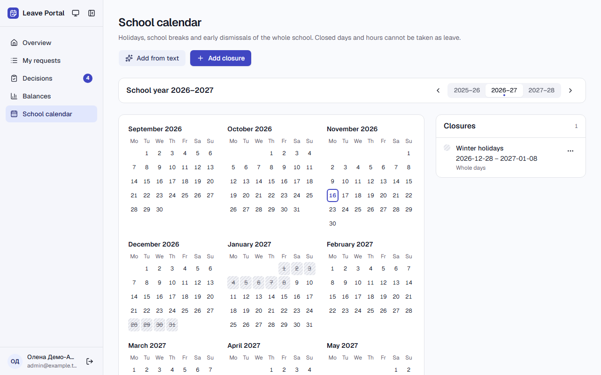
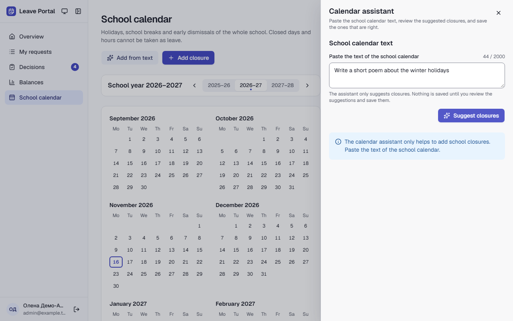
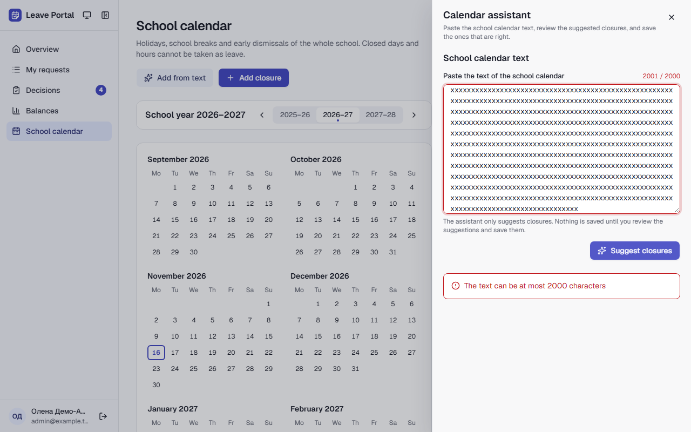
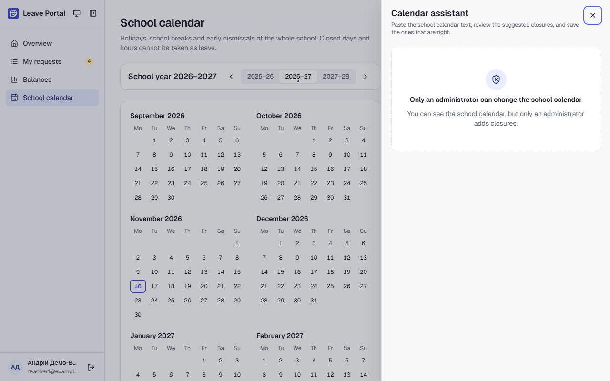

# Звіт UAT — 16.11.2026

- **Застосунок:** https://leave-portal-olive.vercel.app (/api/health: коміт `23571b3`)
- **Код тестів:** `task/assistant-uat-final` @ `76e0df6`, дерево чисте
- **Прогін:** 16.11.2026, 11:26 (Київ), Playwright 75.6 с; AC: 4 — PASS 4, FAIL 0, NEEDS-HUMAN 0
- **Рецензент:** `claude-haiku-5-5`; суперечки → `claude-sonnet-5-5`. Разом за розбір: $0.0384 (ціни API; за підпискою — у межах ліміту плану)
- **Прибирання:** рядків UAT шкільного календаря видалено 1 (закриття «Winter holidays» 2026-12-28…2027-01-08 (зі сторінки)), закриттів AC лишилось 0, записів teacher1@ у датах AC лишилось 0
- **Відео й траси:** не в git — `test-results/` локально або артефакт CI; трасу відкриває `npx playwright show-trace <trace.zip>`

| AC | Перевірки | Агент | Підсумок | Чому | Playwright | Розбір |
|---|---|---|---|---|---|---|
| AC-ASSIST-03 | пройшли | Haiku: PASS | **PASS** | R6: перевірки, агент і цитати збігаються | 27.2 с | $0.0018, 8.8 с |
| AC-ASSIST-06 | пройшли | Haiku: NEEDS-HUMAN, Sonnet: PASS | **PASS** | R6: перевірки, агент і цитати збігаються | 10.0 с | $0.0328, 20.5 с |
| AC-ASSIST-10 | пройшли | Haiku: PASS | **PASS** | R6: перевірки, агент і цитати збігаються | 8.4 с | $0.0019, 9.1 с |
| AC-ASSIST-11 | пройшли | Haiku: PASS | **PASS** | R6: перевірки, агент і цитати збігаються | 9.3 с | $0.0019, 8.1 с |

## AC-ASSIST-03 — PASS

**Тест:** AC-ASSIST-03: removes "Teachers' meeting", renames "Winter break" to "Winter holidays" and saves — the calendar shows only "Winter holidays"

**Критерій** (requirements/05-calendar-assistant.md):

> AC-ASSIST-03: Given the 2 suggested closures from AC-ASSIST-01. When the administrator removes "Teachers' meeting", changes the name "Winter break" to "Winter holidays" and saves. Then the school calendar shows only "Winter holidays" 2026-12-28 – 2027-01-08.

**Кроки:** ✔ Дано: the 2 suggested closures from AC-ASSIST-01 → ✔ Коли: the administrator removes "Teachers' meeting", changes the name "Winter break" to "Winter holidays" and saves → ✔ Тоді: the school calendar shows only "Winter holidays" 2026-12-28 – 2027-01-08.

**Агент (claude-haiku-5-5, PASS):** На кадрі сторінки School calendar у списку Closures видно один запис: «Winter holidays», дати 2026-12-28 – 2027-01-08, Whole days. Лічильник у заголовку списку показує 1, «Teachers' meeting» і «Winter break» на екрані відсутні. Частина про збереження панелі не з кадрів і не оцінювалась.

**Цитати агента, звірені зі сторінкою (aria):**
- «Winter holidays» — є на сторінці
- «2026-12-28 – 2027-01-08» — є на сторінці
- «Closures» — є на сторінці
- «1» — є на сторінці

**Правило:** R6: перевірки, агент і цитати збігаються

**Відео:** `test-results/artifacts/calendar-assistant-admin-e-b61e6-shows-only-Winter-holidays--chromium/video.webm` · **траса:** `test-results/artifacts/calendar-assistant-admin-e-b61e6-shows-only-Winter-holidays--chromium/trace.zip` (не в git)

**Рішення PM:** ☐ приймаю · ☐ відхилення від вимог (issue «Відхилення від вимог: AC-ASSIST-03 — …») · @login: ____

## AC-ASSIST-06 — PASS

**Тест:** AC-ASSIST-06: a poem request — no closures suggested, the refusal message

**Критерій** (requirements/05-calendar-assistant.md):

> AC-ASSIST-06: Given the administrator is signed in. When the administrator asks for suggestions for the text "Write a short poem about the winter holidays". Then no closures are suggested, and the administrator sees the message "The calendar assistant only helps to add school closures. Paste the text of the school calendar."

**Кроки:** ✔ Дано: the administrator is signed in → ✔ Коли: the administrator asks for suggestions for the text "Write a short poem about the winter holidays" → ✔ Тоді: no closures are suggested, and the administrator sees the message "The calendar assistant only helps to add school closures. Paste the text of the school calendar."

**Агент (claude-sonnet-5-5, PASS):** На кадрі в панелі Calendar assistant у полі введено «Write a short poem about the winter holidays», під кнопкою «Suggest closures» видно інформаційне повідомлення з точним текстом критерію (перенесеним на два рядки). Списку запропонованих закриттів і кнопки «Save closures» у панелі немає.

Haiku сказав NEEDS-HUMAN, тож розбір повторив Sonnet; рішення агента — за Sonnet.

**Цитати агента, звірені зі сторінкою (aria):**
- «The calendar assistant only helps to add school closures. Paste the text of the school calendar.» — є на сторінці
- «The calendar assistant only helps to add school closures. Paste the text of the school calendar.» — є на сторінці

**Правило:** R6: перевірки, агент і цитати збігаються

**Відео:** `test-results/artifacts/calendar-assistant-admin-e-abaf6-ggested-the-refusal-message-chromium/video.webm` · **траса:** `test-results/artifacts/calendar-assistant-admin-e-abaf6-ggested-the-refusal-message-chromium/trace.zip` (не в git)

**Рішення PM:** ☐ приймаю · ☐ відхилення від вимог (issue «Відхилення від вимог: AC-ASSIST-06 — …») · @login: ____

## AC-ASSIST-10 — PASS

**Тест:** AC-ASSIST-10: a text of 2001 characters — the assistant is not asked, the length message

**Критерій** (requirements/05-calendar-assistant.md):

> AC-ASSIST-10: Given the administrator pastes a text of 2001 characters. When the administrator asks for suggestions. Then the calendar assistant is not asked, and the administrator sees the message "The text can be at most 2000 characters".

**Кроки:** ✔ Дано: the administrator pastes a text of 2001 characters → ✔ Коли: the administrator asks for suggestions → ✔ Тоді: the calendar assistant is not asked, and the administrator sees the message "The text can be at most 2000 characters".

**Агент (claude-haiku-5-5, PASS):** На кадрі в панелі «Calendar assistant» видно лічильник «2001 / 2000» біля поля тексту та червоне повідомлення «The text can be at most 2000 characters», які збігаються з критерієм посимвольно. Частина про те, що асистента не викликали, не видима на кадрі й оцінена як cannot-tell.

**Цитати агента, звірені зі сторінкою (aria):**
- «The text can be at most 2000 characters» — є на сторінці
- «2001 / 2000» — є на сторінці

**Правило:** R6: перевірки, агент і цитати збігаються

**Відео:** `test-results/artifacts/calendar-assistant-admin-e-95c32-ot-asked-the-length-message-chromium/video.webm` · **траса:** `test-results/artifacts/calendar-assistant-admin-e-95c32-ot-asked-the-length-message-chromium/trace.zip` (не в git)

**Рішення PM:** ☐ приймаю · ☐ відхилення від вимог (issue «Відхилення від вимог: AC-ASSIST-10 — …») · @login: ____

## AC-ASSIST-11 — PASS

**Тест:** AC-ASSIST-11: teacher1@example.test opens the calendar assistant by a direct link — «Only an administrator can change the school calendar»

**Критерій** (requirements/05-calendar-assistant.md):

> AC-ASSIST-11: Given teacher1@example.test is signed in and has only the employee role. When teacher1@example.test opens the calendar assistant by a direct link. Then teacher1@example.test sees the message "Only an administrator can change the school calendar", and no closures are suggested or saved.

**Кроки:** ✔ Дано: teacher1@example.test is signed in and has only the employee role → ✔ Коли: teacher1@example.test opens the calendar assistant by a direct link → ✔ Тоді: teacher1@example.test sees the message "Only an administrator can change the school calendar", and no closures are suggested or saved.

**Агент (claude-haiku-5-5, PASS):** На кадрі в панелі «Calendar assistant» показано точний текст «Only an administrator can change the school calendar» з підказкою про перегляд календаря. Поля вставки тексту, кнопок «Suggest closures» і «Save closures» на кадрі немає; у цитаті для другої частини наведено видимий підзаголовок панелі, бо відсутність елементів сама по собі текстом не передається.

**Цитати агента, звірені зі сторінкою (aria):**
- «Only an administrator can change the school calendar» — є на сторінці
- «You can see the school calendar, but only an administrator adds closures.» — є на сторінці

**Правило:** R6: перевірки, агент і цитати збігаються

**Відео:** `test-results/artifacts/calendar-assistant-teacher-7e034-change-the-school-calendar»-chromium/video.webm` · **траса:** `test-results/artifacts/calendar-assistant-teacher-7e034-change-the-school-calendar»-chromium/trace.zip` (не в git)

**Рішення PM:** ☐ приймаю · ☐ відхилення від вимог (issue «Відхилення від вимог: AC-ASSIST-11 — …») · @login: ____

## Як читати підсумок

- **PASS** — автоматичні перевірки пройшли, агент-рецензент погодився з кадром, а кожну його цитату знайдено на сторінці.
- **FAIL** — впала автоматична перевірка. Агент цього не перекриває: невидимі вади (буфер обміну, база) він на кадрі не побачить.
- **NEEDS-HUMAN** — перевірки зелені, але агент не погодився або його цитати немає на сторінці. Часто це слабкий тест або розбіжність між текстом AC і тестом — питання до PM, а не обов'язково вада продукту.

Правила: R1: перевірка впала — FAIL завжди, агент не перекриває; R2: немає вердикту агента або кадру; R3: перевірки пройшли, агент не погоджується — вирішує людина; R4: цитати агента немає на сторінці (aria) — не підтверджено; R5: помилка сторінки або 5xx під час сценарію; R6: перевірки, агент і цитати збігаються.
