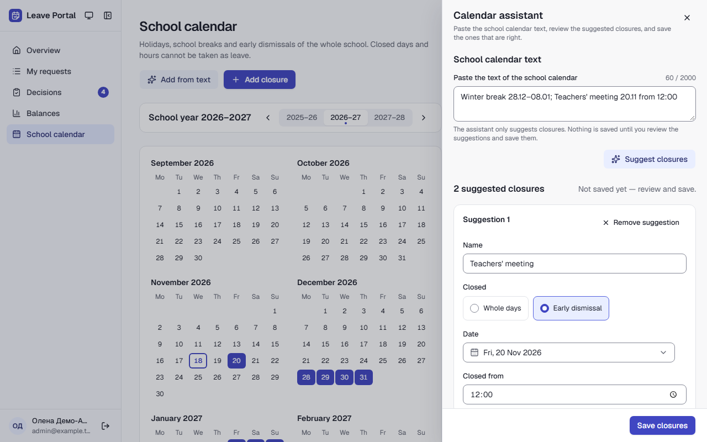

# Звіт UAT — 18.11.2026

- **Застосунок:** https://leave-portal-olive.vercel.app (/api/health: коміт `fc2a859`)
- **Код тестів:** `task/assistant-uat-ac01` @ `7bd84b7`, дерево чисте
- **Прогін:** 18.11.2026, 10:25 (Київ), Playwright 98.2 с; AC: 1 — PASS 0, FAIL 0, NEEDS-HUMAN 1
- **Рецензент:** `claude-haiku-5-5`; суперечки → `claude-sonnet-5-5`. Разом за розбір: $0.0476 (ціни API; за підпискою — у межах ліміту плану)
- **Прибирання:** рядків UAT шкільного календаря видалено 0 (—), закриттів AC лишилось 0, записів teacher1@ у датах AC лишилось 0
- **Відео й траси:** не в git — `test-results/` локально або артефакт CI; трасу відкриває `npx playwright show-trace <trace.zip>`

| AC | Перевірки | Агент | Підсумок | Чому | Playwright | Розбір |
|---|---|---|---|---|---|---|
| AC-ASSIST-01 | пройшли | Haiku: NEEDS-HUMAN, Sonnet: NEEDS-HUMAN | **NEEDS-HUMAN** | R3: перевірки пройшли, агент не погоджується — вирішує людина | 46.4 с | $0.0476, 31.2 с |

## AC-ASSIST-01 — NEEDS-HUMAN

**Тест:** AC-ASSIST-01: "Winter break 28.12–08.01; Teachers' meeting 20.11 from 12:00" — 2 suggested closures, and the school calendar still has no closures

**Критерій** (requirements/05-calendar-assistant.md):

> AC-ASSIST-01: Given today is Friday 2026-11-13 and the school calendar has no closures. When the administrator asks the calendar assistant for suggestions for the text "Winter break 28.12–08.01; Teachers' meeting 20.11 from 12:00". Then the administrator sees 2 suggested closures — "Winter break" whole days 2026-12-28 – 2027-01-08 and "Teachers' meeting" early dismissal on 2026-11-20 from 12:00 — and the school calendar still has no closures.

**Кроки:** ✔ Дано: the school calendar has no closures (on the dates of the AC: 2026-11-20 – 2027-01-08) → ✔ Коли: the administrator asks the calendar assistant for suggestions for the text "Winter break 28.12–08.01; Teachers' meeting 20.11 from 12:00" → ✔ Тоді: the administrator sees 2 suggested closures — "Winter break" whole days 2026-12-28 – 2027-01-08 and "Teachers' meeting" early dismissal on 2026-11-20 from 12:00 — and the school calendar still has no closures.

**Агент (claude-sonnet-5-5, NEEDS-HUMAN):** На кадрі видно заголовок «2 suggested closures» з «Not saved yet — review and save.» і першу пропозицію Teachers' meeting (Early dismissal, Fri, 20 Nov 2026, Closed from 12:00). Пропозиція Winter break лежить нижче видимої області й не видна, тому третю частину «Тоді» підтвердити неможливо.

Haiku сказав NEEDS-HUMAN, тож розбір повторив Sonnet; рішення агента — за Sonnet.

**Агент бачить вади:**
- Друга пропозиція (Winter break) на кадрі не видна: панель обрізана внизу після першої пропозиції, тому «Winter break», «Whole days» і дати 28 Dec 2026 – 8 Jan 2027 підтвердити неможливо.
- На календарі за панеллю виділені 20 листопада та 28–31 грудня. Незрозуміло, чи це попередній перегляд пропозицій, чи вже наявні закриття; це лише спостереження, його перевіряють автоматичні перевірки.

**Цитати агента, звірені зі сторінкою (aria):**
- «2 suggested closures» — є на сторінці
- «Not saved yet — review and save.» — є на сторінці
- «Teachers' meeting» — є на сторінці
- «Early dismissal» — є на сторінці
- «Fri, 20 Nov 2026» — є на сторінці
- «Closed from» — є на сторінці
- «12:00» — є на сторінці

**Правило:** R3: перевірки пройшли, агент не погоджується — вирішує людина

**Відео:** `test-results/artifacts/calendar-assistant-admin-e-33319-endar-still-has-no-closures-chromium/video.webm` · **траса:** `test-results/artifacts/calendar-assistant-admin-e-33319-endar-still-has-no-closures-chromium/trace.zip` (не в git)

**Рішення PM:** ☐ приймаю · ☐ відхилення від вимог (issue «Відхилення від вимог: AC-ASSIST-01 — …») · @login: ____

## Як читати підсумок

- **PASS** — автоматичні перевірки пройшли, агент-рецензент погодився з кадром, а кожну його цитату знайдено на сторінці.
- **FAIL** — впала автоматична перевірка. Агент цього не перекриває: невидимі вади (буфер обміну, база) він на кадрі не побачить.
- **NEEDS-HUMAN** — перевірки зелені, але агент не погодився або його цитати немає на сторінці. Часто це слабкий тест або розбіжність між текстом AC і тестом — питання до PM, а не обов'язково вада продукту.

Правила: R1: перевірка впала — FAIL завжди, агент не перекриває; R2: немає вердикту агента або кадру; R3: перевірки пройшли, агент не погоджується — вирішує людина; R4: цитати агента немає на сторінці (aria) — не підтверджено; R5: помилка сторінки або 5xx під час сценарію; R6: перевірки, агент і цитати збігаються.
